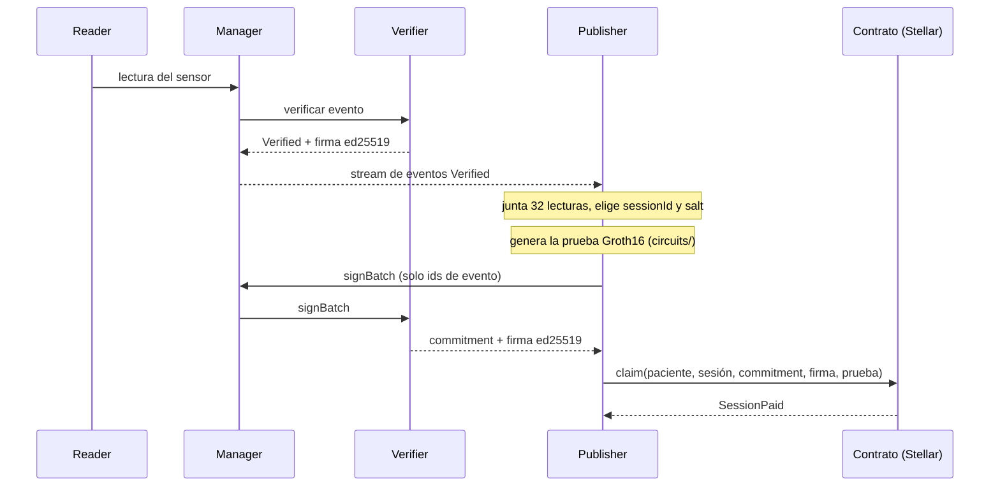

# Phonendo

Phonendo recoge datos de sensores, verifica su integridad y los guarda, y en Stellar
demuestra que cumplen una condición **sin revelarlos**. Un contrato Soroban comprueba
la prueba y paga automáticamente. Nació como prototipo académico que publicaba en IOTA
y en HackMeridian 2026 (Lisboa) se ha llevado a Stellar con pruebas de conocimiento
cero (ZK): ruta Genesis, con los temas Stellar Unlocked y Stellar Composed.

## Qué resuelve

Caso principal: **adherencia a la rehabilitación cardíaca**. Una aseguradora paga a la
paciente una recompensa en USDC por cada sesión completada. La sesión cuenta si el
pulso se mantuvo en la zona que marca el médico (por ejemplo, 90-130 pulsaciones por
minuto) durante suficientes lecturas. La aseguradora solo ve "sesión cumplida" y el
pago, nunca el pulso. Los datos de salud son una categoría especial en el RGPD, por
eso no salen del sistema.

El mismo circuito sirve para otros casos cambiando solo la política. Por ejemplo, en
la cadena de frío un comprador paga cuando el envío se mantuvo en el rango de
temperatura.

## Cómo funciona



1. El Reader entrega cada lectura al Manager, que la pasa al Verifier. El Verifier
   comprueba el evento, lo firma y el Manager lo guarda en Storage.
2. El Publisher escucha el stream del Manager y junta 32 lecturas Verified de un
   dispositivo.
3. Con `circuits/` genera una prueba Groth16 de que al menos 28 de las 32 lecturas
   están dentro del rango, sin revelarlas. La prueba lleva un *commitment* (una
   huella Poseidon de las lecturas y una sal aleatoria).
4. El Publisher pide la firma del lote al Verifier a través del Manager. Solo envía
   los ids de los eventos: el Verifier calcula el commitment con las lecturas que él
   mismo verificó y lo firma con ed25519. Así quien cobra no puede firmar sus propios
   datos.
5. `claim()` comprueba, por orden, que la sesión no se cobró antes, la firma del
   Verifier y la prueba con la política guardada en el contrato. Si todo es válido,
   transfiere el pago a la paciente y emite `SessionPaid`.

En la cadena solo hay el commitment, los parámetros públicos, el identificador de
sesión, el resultado y el pago. Nunca lecturas ni datos personales.

## Funciones nativas de Stellar que usa

| Función nativa | Dónde se usa |
| --- | --- |
| Operaciones BLS12-381 de Soroban (CAP-59) | `claim()` comprueba la prueba Groth16 con `pairing_check`. |
| Verificación ed25519 del host | `claim()` comprueba la firma del Verifier sobre `commitment \|\| sessionId \|\| cuenta de la paciente`. |
| Contrato del token (USDC o XLM) | `claim()` transfiere el pago desde el saldo del contrato a la paciente. |
| Almacenamiento persistente con TTL | Cada sesión cobrada queda marcada y no se puede cobrar dos veces. |
| Eventos de contrato | `SessionPaid` anuncia cada pago para el panel y los exploradores. |
| Cuentas Stellar (`G...`) | La clave de la cuenta de la paciente va dentro del mensaje firmado. |

## Despliegues en testnet

Política: de 90 a 130 pulsaciones, al menos 28 lecturas de 32, pago de 5 unidades.

| Qué | Dato |
| --- | --- |
| Contrato `adherence` (paga XLM) | [`CAPZ2O7LPTRGJ2Q7TTHMCHOKRZ4T7KU5I4E74M2U3YUTC3XONIQDOP2D`](https://stellar.expert/explorer/testnet/contract/CAPZ2O7LPTRGJ2Q7TTHMCHOKRZ4T7KU5I4E74M2U3YUTC3XONIQDOP2D) |
| Primer cobro real: prueba ZK y firma verificadas en cadena, 5 XLM | [`891b2fe1…c0aa1`](https://stellar.expert/explorer/testnet/tx/891b2fe1504a9d9c0a34146828e9caac9527a41e3d467eaecf5a994c145c0aa1) |
| Contrato `adherence` de rehabilitación (paga 0,1 USDC por sesión) | [`CD3ZLDTB7QKJLMAIBSCL75TRHE6IUZ27RW5FLWNB4F3GUQENZZZSM45H`](https://stellar.expert/explorer/testnet/contract/CD3ZLDTB7QKJLMAIBSCL75TRHE6IUZ27RW5FLWNB4F3GUQENZZZSM45H) |
| Contrato `adherence` anterior (formato de firma antiguo, retirado) | [`CBF2MBQ6W4S6LD3JSIM3NNZET5KBUKOADRZSKIYZRZBAXRM6OJZCNSFI`](https://stellar.expert/explorer/testnet/contract/CBF2MBQ6W4S6LD3JSIM3NNZET5KBUKOADRZSKIYZRZBAXRM6OJZCNSFI) |
| Despliegue del contrato USDC | [`87b7301d…8beffd`](https://stellar.expert/explorer/testnet/tx/87b7301d2e721070e87a12cfc7aff0927ec53055c4a18ac117cb42441a8beffd) |
| Fondos del contrato USDC (20 USDC) | [`f791426c…c4fa`](https://stellar.expert/explorer/testnet/tx/f791426c649045fc02dfbbf7cc69d1b6796292d53da0a4455a6499a0657dc4fa) |
| Primer cobro real en USDC: 5 USDC a la paciente, evento `SessionPaid` | [`0ba0adb7…e78033`](https://stellar.expert/explorer/testnet/tx/0ba0adb7ca42e09350f71eec15c09d252dcfacf13b6cc3672afab8017ce78033) |
| Cobro de extremo a extremo: Reader simulado de pulso → Manager → Verifier → Publisher → `claim()`, 5 USDC | [`2a345e9f…06ef47`](https://stellar.expert/explorer/testnet/tx/2a345e9fdf594fc385107a2e1a2e973d3cb16f5274fc14e763bbe9dc0406ef47) |
| Contrato `adherence` de cadena de frío (2–8 °C, paga USDC) | [`CDNPBN6HZP4PZKRFOOA2PYC772KF4THXTJNKHBS5Y33HCAVDWCVO5SRE`](https://stellar.expert/explorer/testnet/contract/CDNPBN6HZP4PZKRFOOA2PYC772KF4THXTJNKHBS5Y33HCAVDWCVO5SRE) |
| Cobro de cadena de frío: Reader simulado de temperatura → Publisher → `claim()`, 5 USDC | [`639fcfdd…a9efb6`](https://stellar.expert/explorer/testnet/tx/639fcfddd74ddcd1344a26cd1638ac5f66e12a7bc2f69be04da8fb7815a9efb6) |
| Emisor de USDC en testnet | `GBBD47IF6LWK7P7MDEVSCWR7DPUWV3NY3DTQEVFL4NAT4AQH3ZLLFLA5` |

## Servicios

| Servicio | Responsabilidad |
| --- | --- |
| **Reader** | Recoge observaciones y las expone mediante un stream SSE. |
| **Manager** | Coordina el flujo, calcula el hash del contenido del evento y gestiona los reintentos por timeout. |
| **Verifier** | Valida el evento, comprueba el hash y firma con ed25519 el resultado verificado y los lotes de lecturas. |
| **Storage** | Guarda los eventos verificados y gestiona su propia base de datos. |
| **Publisher** | Agrupa lecturas Verified del Manager, genera la prueba ZK y cobra la sesión en Stellar. |

## Arquitectura general


El Manager consume las observaciones del Reader por SSE. Si un mismo Reader envía
eventos por `/newEvent`, el Manager permite solo el primer transporte seleccionado
para ese Reader (HTTP o SSE) durante su ejecución.
La verificación admite HTTP o SSE. El guardado puede utilizar HTTP o las
suscripciones de Storage a las salidas del Manager.
El Verifier también consume streams de Managers y publica resultados por SSE;
el Manager puede suscribirse a ellos para continuar el guardado. Storage expone
su stream después de escribir los eventos.

En cada JSON, `stream` expone el stream propio y `subscriptions` contiene los
streams que consume. El Manager usa `outputStreams` para sus salidas específicas
hacia Verifiers y Storages, separadas de su `/stream` general.

## Secuencia general


Solo se guarda el evento tras una verificación positiva. Un rechazo explícito lo
descarta; un timeout lo deja en una cola temporal en memoria para reintentarlo.
El Publisher solo habla con el Manager (y con Stellar) y no tiene contacto directo
con el Verifier.

## Docker

Para construir y arrancar los cinco servicios, incluido el Publisher:

```sh
docker compose -f deploy/docker/compose.yml up --build -d --wait
```

[Configuración, puertos y pruebas con Docker](deploy/docker/README.md).

## Ejecución local

Requisitos: Python 3.11 o superior, soporte para entornos virtuales y `pip`.

Configura `deploy/env/dev.env` con los puertos y secretos, y las listas de
conexiones en `apps/reader/config.json`, `apps/manager/config.json`, `apps/verifier/config.json` y
`apps/storage/config.json`. Después genera sus configuraciones y arranca el entorno:

```sh
./tools/generate_configs.sh
./tools/dev.sh
```

El generador escribe los archivos `config.env` de los servicios. El Reader del
entorno local utiliza el ejemplo Linux con observaciones simuladas.

## Cobro de una sesión

Requiere Node.js, `circom` 2.2, Rust, Stellar CLI y una cuenta de testnet configurada
en la CLI. Los pasos del contrato están en [contracts](contracts/README.md) y los del
circuito en [circuits](circuits/README.md).

```sh
cd circuits && npm install && npm run setup     # una vez, tarda unos minutos
node scripts/sign.js <cuenta G de la paciente>  # crea la clave de desarrollo del Verifier
cd .. && ./tools/generate_configs.sh            # la copia a apps/verifier/signing_key.json
docker compose -f deploy/docker/compose.yml up --build -d --wait
```

El contrato debe desplegarse con la clave pública que imprime `sign.js` y con la misma
política que `apps/publisher/config.json`. El Reader simulado de Docker emite pulso de
95 a 120 y luego temperatura de 2 a 8 °C (`"simulation": "demo"` en `deploy/docker/reader.json`), cada caso con su contrato y su política. Con un sensor real
se sustituye por el Reader del sensor.

## Seguridad y límites

- Se confía en el Verifier de Phonendo y en el sensor: la firma del Verifier dice que
  las lecturas son las que él comprobó. El siguiente paso es que el propio sensor
  firme cada lectura.
- La ceremonia de las claves de la prueba (`npm run setup`) la hace un solo
  participante y solo vale para desarrollo. En producción sería multiparte.
- El circuito usa Poseidon con las constantes de BN254 sobre el campo de BLS12-381.
  Funciona y está probado contra el circuito, pero no son los parámetros estándar.
- El Publisher guarda los lotes en memoria: si se detiene, pierde el lote en curso y
  no reintenta los cobros.
- El contrato está en testnet y no está auditado.
- Las claves, los `config.env` y los datos locales no se versionan: se generan con
  `tools/generate_configs.sh`. La clave RSA antigua del Verifier sigue en el historial
  de git y no debe reutilizarse.

## Trabajo previo y novedades

Phonendo existía antes del evento como prototipo académico que publicaba en IOTA, sin
código de Stellar, pruebas ZK ni pagos.

| Antes del evento | Hecho en el evento |
| --- | --- |
| Reader, Manager, Verifier y Storage en Python, pila Docker y pruebas | Circuito ZK y scripts de prueba (`circuits/`) |
| Publisher como carpeta vacía | Publisher: lotes, prueba, firma del lote y llamada a `claim()` |
| El Verifier firmaba cada evento con RSA | Una sola clave ed25519 firma los eventos y el commitment del lote |
| Publicación en IOTA (artículo) | Contrato Soroban: prueba Groth16, antirrepetición y pago |

## Hoja de ruta

1. Firma de cada lectura en el propio dispositivo (ESP32), para no depender de un solo
   Verifier.
2. Varios Verifiers y ceremonia de claves multiparte.
3. Anclar en la cadena la huella de todos los datos verificados, con el dato cifrado
   en Storage.
4. Registro de consentimiento: el paciente concede o retira el acceso a su dato y el
   contrato lo comprueba antes de que Storage lo entregue.

## Laboratorio con interfaz

Para gestionar contenedores Docker, ver sus puertos y crear dispositivos, sensores
y observaciones manuales o periódicas: `./tools/lab.sh`. Permite parar, pausar y
reanudar servicios.
Consulta [las instrucciones del laboratorio](tools/LABORATORIO.md).

## Información y logs

Reader Python, Manager, Verifier, Storage y Publisher exponen, sin token:

- `GET /info`: lista `[{"peer": "...", "transport": "http|sse"}]`.
  SSE muestra conexiones activas; HTTP, destinos configurados o clientes recibidos
  desde el arranque (HTTP no mantiene una conexión permanente).
- `GET /logs`: lista de los últimos 200 mensajes en memoria, sin niveles,
  timestamps ni cuerpos de eventos. Consultarla no genera más logs.

Las rutas de procesamiento conservan su autenticación. Reader C++ todavía no
tiene un servidor HTTP concreto para estas consultas.

## Web de Phonendo

[`apps/web`](apps/web/index.html) es una web estática sin compilación ni dependencias:
se abre con doble clic en `index.html` o se publica tal cual en cualquier hosting
estático (GitHub Pages, Netlify, Vercel). `index.html` solo explica el flujo y lleva a
tres paneles, cada uno en su propia página y sin enlaces entre ellos (pensados para
desplegarse por separado; sus direcciones están en `CONFIG.panels` de `app.js`):

- [`operator.html`](apps/web/operator.html): consola del operador. Mapa de Readers,
  Managers, Verifiers, Storages y Publishers por organización, comprobación de si
  responden y descarga de su configuración JSON (mismo formato que `deploy/docker/*.json`).
- [`patient.html`](apps/web/patient.html): pagos recibidos por una cuenta Stellar.
- [`insurer.html`](apps/web/insurer.html): pagos realizados por el contrato.

Arranque local sin Docker:

```sh
./tools/web.sh
```

El operador ofrece un canvas libre con drag & drop, zoom/pan, Auto layout y
Fit view. Su arquitectura modular está en [service_network](apps/web/service_network/README.md).

Abre dos pestañas automáticamente cuando el servidor responde: el operador en
`http://127.0.0.1:8080/operator.html` y Stellar Expert en testnet con el primer contrato de
`apps/publisher/config.json`, o el explorador general si no hay configurados.
`Ctrl+C` detiene el servidor. Instala Python 3 y el abridor de navegador si faltan
(Debian/Ubuntu). Prepara `.venv` e instala `aiohttp` si falta.
Puedes cambiar el puerto con `WEB_PORT=8081 ./tools/web.sh` y elegir otro JSON
con `PUBLISHER_CONFIG_PATH=deploy/docker/publisher.json ./tools/web.sh`.


Los pagos se leen en el navegador desde los eventos `session_paid` del RPC público de
testnet. Si el RPC no responde, la web lo indica y muestra las transacciones ya
confirmadas. La red editada en la consola se guarda solo en ese navegador.

El operador servido por `tools/web.sh` permite crear Readers Python reales,
añadir dispositivos y sensores, emitir pulsos individuales o 32 lecturas y cambiar
HTTP push, SSE, tokens y Managers en directo. Los Readers viven en memoria y se
detienen al cerrar el script; los secretos no se guardan en el navegador. La API
de control escucha solo en loopback y exige el mismo origen para las acciones.
Servicios externos: logs consultados cada 3 segundos; la edición requiere una API
propia y no está habilitada. SSE exige configurar la suscripción en el Manager.
El recorrido visual confirma únicamente pasos observados, sin simular pagos.

## Panel de observación

El [frontend del panel de observación](apps/control/frontend/README.md) permite
explorar un mapa de servicios con ejemplos simulados, sin arrancar el pipeline.
Está construido con Leptos y su conexión con la API del panel está pendiente.

## Pruebas

Prepara el entorno de pruebas:

```sh
python3 -m venv .venv
.venv/bin/python -m pip install -r tests/requirements.txt
```

Ejecuta las pruebas de los componentes y la integración con servicios reales:

```sh
./tools/test.sh
./tools/test_integration.sh
```

Las pruebas del Reader en C++ requieren un compilador con soporte C++17. La prueba
de integración utiliza puertos y una base de datos temporales, comprueba streams,
firmas e integridad del dato almacenado y cierra los servicios al terminar.

## Documentación y referencia

- [Reader](apps/reader/README.md), [Manager](apps/manager/README.md),
  [Verifier](apps/verifier/README.md), [Storage](apps/storage/README.md) y
  [Publisher](apps/publisher/README.md).
- [Circuito ZK](circuits/README.md) y [contrato Soroban](contracts/README.md).
- [Diagramas y fuentes PlantUML editables](docs/diagramas.md).
- Moya, F., Quesada, F. J., Martínez, L. et al. *Phonendo: a platform for publishing wearable data on distributed ledger technologies*. Wireless Networks (2023). [Publicación original](https://doi.org/10.1007/s11276-023-03458-7).
