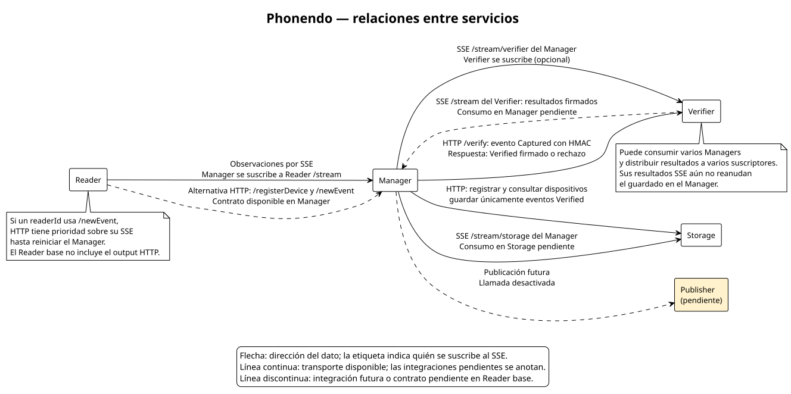
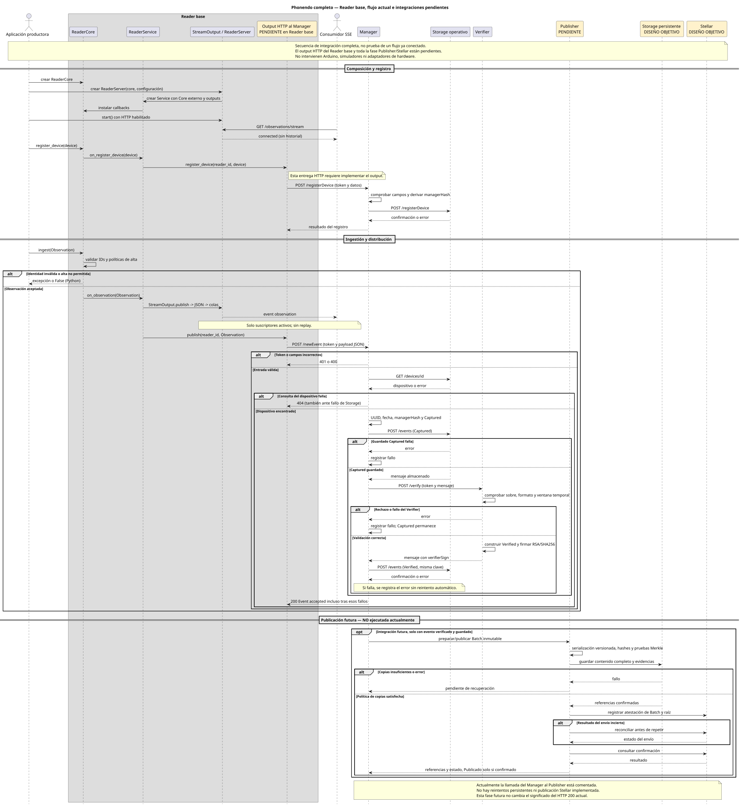

# Phonendo

Phonendo es una plataforma de servicios para recoger datos de dispositivos y sensores,
coordinar su procesamiento, verificar su integridad y almacenarlos. La publicación
de los datos forma parte del diseño y está pendiente de integración.

## Servicios

| Servicio | Responsabilidad |
| --- | --- |
| **Reader** | Recoge observaciones y las expone mediante un stream SSE. |
| **Manager** | Coordina el flujo, calcula el hash del contenido del evento y gestiona los reintentos por timeout. |
| **Verifier** | Valida el evento, comprueba el hash y firma el resultado verificado. |
| **Storage** | Guarda los eventos verificados y gestiona su propia base de datos. |
| **Publisher** | Agrupa lecturas Verified del Manager, genera la prueba ZK y cobra la sesión en Stellar. |

## Arquitectura general



El Manager consume las observaciones del Reader por SSE. Si un mismo Reader envía
eventos por `/newEvent`, el Manager permite solo el primer transporte seleccionado
para ese Reader (HTTP o SSE) durante su ejecución.
La verificación admite HTTP o SSE. El guardado puede utilizar HTTP o las
suscripciones de Storage a las salidas del Manager.
El Verifier también consume streams de Managers y publica resultados por SSE;
el Manager puede suscribirse a ellos para continuar el guardado. Storage expone
su stream después de escribir los eventos.

En cada JSON, `stream` expone el stream propio y `subscriptions` contiene los
streams que consume. El Manager usa `outputStreams` para sus salidas específicas
hacia Verifiers y Storages, separadas de su `/stream` general.

## Secuencia general



Solo se guarda el evento tras una verificación positiva. Un rechazo explícito lo
descarta; un timeout lo deja en una cola temporal en memoria para reintentarlo.
Publisher aparece como una fase futura.

## Docker

Para construir y arrancar los cuatro servicios:

```sh
docker compose -f deploy/docker/compose.yml up --build -d --wait
```

[Configuración, puertos y pruebas con Docker](deploy/docker/README.md).

## Ejecución local

Requisitos: Python 3.11 o superior, soporte para entornos virtuales y `pip`.

Configura `deploy/env/dev.env` con los puertos y secretos, y las listas de
conexiones en `apps/reader/config.json`, `apps/manager/config.json`, `apps/verifier/config.json` y
`apps/storage/config.json`. Después genera sus configuraciones y arranca el entorno:

```sh
./tools/generate_configs.sh
./tools/dev.sh
```

El generador escribe los archivos `config.env` de los servicios. El Reader del
entorno local utiliza el ejemplo Linux con observaciones simuladas.

## Laboratorio con interfaz

Para gestionar contenedores Docker, ver sus puertos y crear dispositivos, sensores
y observaciones manuales o periódicas: `./tools/lab.sh`. Permite parar, pausar y
reanudar servicios.
Consulta [las instrucciones del laboratorio](tools/LABORATORIO.md).

## Información y logs

Reader Python, Manager, Verifier y Storage exponen, sin token:

- `GET /info`: lista `[{"peer": "...", "transport": "http|sse"}]`.
  SSE muestra conexiones activas; HTTP, destinos configurados o clientes recibidos
  desde el arranque (HTTP no mantiene una conexión permanente).
- `GET /logs`: lista de los últimos 200 mensajes en memoria, sin niveles,
  timestamps ni cuerpos de eventos. Consultarla no genera más logs.

Las rutas de procesamiento conservan su autenticación. Publisher y Reader C++
todavía no tienen un servidor HTTP concreto para estas consultas.

## Pruebas

Prepara el entorno de pruebas:

```sh
python3 -m venv .venv
.venv/bin/python -m pip install -r tests/requirements.txt
```

Ejecuta las pruebas de los componentes y la integración con servicios reales:

```sh
./tools/test.sh
./tools/test_integration.sh
```

Las pruebas del Reader en C++ requieren un compilador con soporte C++17. La prueba
de integración utiliza puertos y una base de datos temporales, comprueba streams,
firmas e integridad del dato almacenado y cierra los servicios al terminar.

## Documentación y referencia

- [Reader](apps/reader/README.md), [Manager](apps/manager/README.md),
  [Verifier](apps/verifier/README.md), [Storage](apps/storage/README.md) y
  [Publisher](apps/publisher/README.md).
- [Diagramas y fuentes PlantUML editables](docs/diagramas.md).
- Moya, F., Quesada, F. J., Martínez, L. et al. *Phonendo: a platform for publishing wearable data on distributed ledger technologies*. Wireless Networks (2023). [Publicación original](https://doi.org/10.1007/s11276-023-03458-7).
