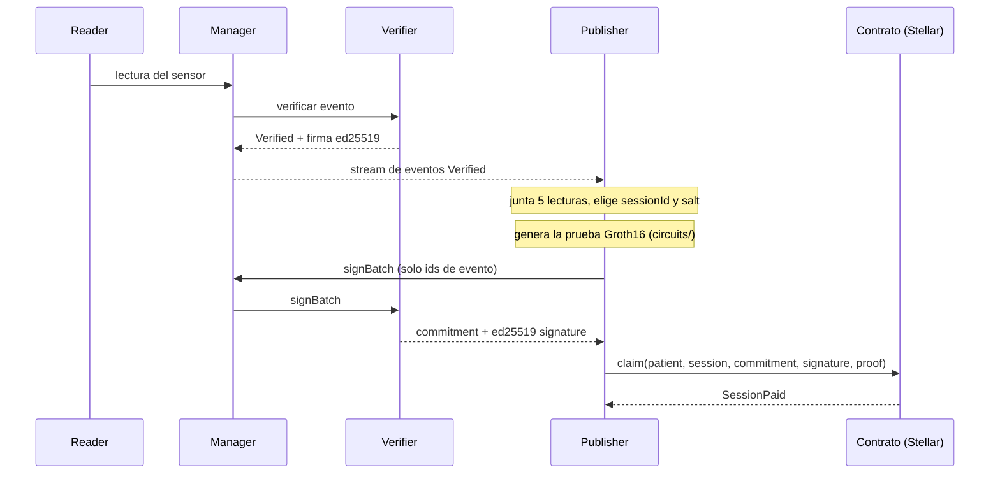
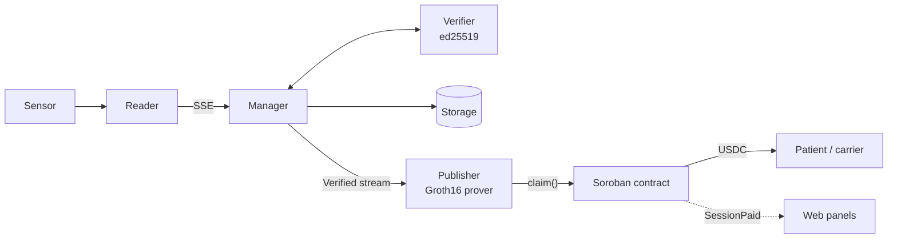

# Phonendo

**Private sensor data, public proof, automatic payment on Stellar.**

Phonendo collects sensor readings, verifies their integrity and stores them. On Stellar it
proves that the readings meet a condition **without revealing them**: a Soroban contract
checks a zero-knowledge (ZK) proof and pays automatically.

Built for **HackMeridian 2026** (Lisbon) · Genesis track · Stellar Unlocked & Stellar Composed.


**Live demo:** https://phonendo.vercel.app

---

## Contents

- [The problem](#the-problem)
- [How it works](#how-it-works)
- [Stellar features used](#stellar-features-used)
- [Testnet deployments](#testnet-deployments)
- [Architecture](#architecture)
- [Quick start](#quick-start)
- [Claiming a session](#claiming-a-session)
- [Environment variables](#environment-variables)
- [Web panels](#web-panels)
- [Tests](#tests)
- [Security and limits](#security-and-limits)
- [Roadmap](#roadmap)
- [Documentation](#documentation)

---

## The problem

**Main use case: cardiac rehabilitation adherence.** An insurer pays the patient a USDC
reward for every completed session. A session counts when the heart rate stayed in the
zone set by the doctor (for example 90-130 bpm) for enough readings.

The insurer only sees "session completed" and the payment, never the heart rate. Health
data is a special category under the GDPR, so it never leaves the system.

The same circuit serves other cases by changing only the policy. In the **cold chain**, a
buyer pays when a shipment stayed inside its temperature range.

| | Cardiac rehabilitation | Cold chain |
| --- | --- | --- |
| Who pays | Insurer | Buyer |
| Who gets paid | Patient | Carrier |
| Policy | 90-130 bpm in at least 28 of 32 readings | 2-8 °C |
| What goes on-chain | Commitment, policy, session id, result, payment | Same |
| What stays private | Every heart-rate reading | Every temperature reading |

---

## How it works



1. El Reader entrega cada lectura al Manager, que la pasa al Verifier. El Verifier
   comprueba el evento, lo firma y el Manager lo guarda en Storage.
2. El Publisher escucha el stream del Manager y junta 5 lecturas Verified de un
   dispositivo.
3. Con `circuits/` genera una prueba Groth16 de que al menos 4 de las 5 lecturas
   están dentro del rango, sin revelarlas. La prueba lleva un *commitment* (una
   huella Poseidon de las lecturas y una sal aleatoria).
4. El Publisher pide la firma del lote al Verifier a través del Manager. Solo envía
   los ids de los eventos: el Verifier calcula el commitment con las lecturas que él
   mismo verificó y lo firma con ed25519. Así quien cobra no puede firmar sus propios
   datos.
5. `claim()` comprueba, por orden, que la sesión no se cobró antes, la firma del
   Verifier y la prueba con la política guardada en el contrato. Si todo es válido,
   transfiere el pago a la paciente y emite `SessionPaid`.

En la cadena solo hay el commitment, los parámetros públicos, el identificador de
sesión, el resultado y el pago. Nunca lecturas ni datos personales.

## Funciones nativas de Stellar que usa

| Función nativa | Dónde se usa |
| --- | --- |
| Operaciones BLS12-381 de Soroban (CAP-59) | `claim()` comprueba la prueba Groth16 con `pairing_check`. |
| Verificación ed25519 del host | `claim()` comprueba la firma del Verifier sobre `commitment \|\| sessionId \|\| cuenta de la paciente`. |
| Contrato del token (USDC o XLM) | `claim()` transfiere el pago desde el saldo del contrato a la paciente. |
| Almacenamiento persistente con TTL | Cada sesión cobrada queda marcada y no se puede cobrar dos veces. |
| Eventos de contrato | `SessionPaid` anuncia cada pago para el panel y los exploradores. |
| Cuentas Stellar (`G...`) | La clave de la cuenta de la paciente va dentro del mensaje firmado. |

## Despliegues en testnet

Política de rehabilitación: de 90 a 130 pulsaciones, al menos 4 lecturas de 5. Los primeros
cobros pagaron 5 unidades; ahora cada sesión paga 0,1 USDC para poder repetir la demo.

| Qué | Dato |
| --- | --- |
| Contrato `adherence` (paga XLM) | [`CAPZ2O7LPTRGJ2Q7TTHMCHOKRZ4T7KU5I4E74M2U3YUTC3XONIQDOP2D`](https://stellar.expert/explorer/testnet/contract/CAPZ2O7LPTRGJ2Q7TTHMCHOKRZ4T7KU5I4E74M2U3YUTC3XONIQDOP2D) |
| Primer cobro real: prueba ZK y firma verificadas en cadena, 5 XLM | [`891b2fe1…c0aa1`](https://stellar.expert/explorer/testnet/tx/891b2fe1504a9d9c0a34146828e9caac9527a41e3d467eaecf5a994c145c0aa1) |
| Contrato `adherence` de rehabilitación (lotes de 5, 4 de 5; paga 0,1 USDC por sesión) | [`CCLQFKRWBLRSPLVAFWBLG22LPRGP3GEV47CGXA6C3VAGPQ2QITE3DNYL`](https://stellar.expert/explorer/testnet/contract/CCLQFKRWBLRSPLVAFWBLG22LPRGP3GEV47CGXA6C3VAGPQ2QITE3DNYL) |
| Contrato `adherence` de rehabilitación con lotes de 32 (retirado) | [`CD3ZLDTB7QKJLMAIBSCL75TRHE6IUZ27RW5FLWNB4F3GUQENZZZSM45H`](https://stellar.expert/explorer/testnet/contract/CD3ZLDTB7QKJLMAIBSCL75TRHE6IUZ27RW5FLWNB4F3GUQENZZZSM45H) |
| Contrato `adherence` anterior (formato de firma antiguo, retirado) | [`CBF2MBQ6W4S6LD3JSIM3NNZET5KBUKOADRZSKIYZRZBAXRM6OJZCNSFI`](https://stellar.expert/explorer/testnet/contract/CBF2MBQ6W4S6LD3JSIM3NNZET5KBUKOADRZSKIYZRZBAXRM6OJZCNSFI) |
| Despliegue del contrato USDC | [`87b7301d…8beffd`](https://stellar.expert/explorer/testnet/tx/87b7301d2e721070e87a12cfc7aff0927ec53055c4a18ac117cb42441a8beffd) |
| Fondos del contrato USDC (20 USDC) | [`f791426c…c4fa`](https://stellar.expert/explorer/testnet/tx/f791426c649045fc02dfbbf7cc69d1b6796292d53da0a4455a6499a0657dc4fa) |
| Primer cobro real en USDC: 5 USDC a la paciente, evento `SessionPaid` | [`0ba0adb7…e78033`](https://stellar.expert/explorer/testnet/tx/0ba0adb7ca42e09350f71eec15c09d252dcfacf13b6cc3672afab8017ce78033) |
| Cobro de extremo a extremo: Reader simulado de pulso → Manager → Verifier → Publisher → `claim()`, 5 USDC | [`2a345e9f…06ef47`](https://stellar.expert/explorer/testnet/tx/2a345e9fdf594fc385107a2e1a2e973d3cb16f5274fc14e763bbe9dc0406ef47) |
| Contrato `adherence` de cadena de frío (2–8 °C, 5 de 5; paga 0,1 USDC) | [`CACUZG5V45NPFFB5JSLHMTF6NHEP5GMGZ5QJKJPET4ZIRTWOW6VS2VQS`](https://stellar.expert/explorer/testnet/contract/CACUZG5V45NPFFB5JSLHMTF6NHEP5GMGZ5QJKJPET4ZIRTWOW6VS2VQS) |
| Contrato `adherence` de cadena de frío con lotes de 32 (retirado) | [`CDNPBN6HZP4PZKRFOOA2PYC772KF4THXTJNKHBS5Y33HCAVDWCVO5SRE`](https://stellar.expert/explorer/testnet/contract/CDNPBN6HZP4PZKRFOOA2PYC772KF4THXTJNKHBS5Y33HCAVDWCVO5SRE) |
| Cobro de cadena de frío: Reader simulado de temperatura → Publisher → `claim()`, 5 USDC | [`639fcfdd…a9efb6`](https://stellar.expert/explorer/testnet/tx/639fcfddd74ddcd1344a26cd1638ac5f66e12a7bc2f69be04da8fb7815a9efb6) |
| Demo secuencial en Docker, rehabilitación: pulso simulado → `claim()`, 0,1 USDC | [`084d4e82…bb1ed`](https://stellar.expert/explorer/testnet/tx/084d4e8223cb1a2db2d040920c59b19aa10968352815839e4134836f70fbb1ed) |
| Demo secuencial en Docker, cadena de frío: temperatura simulada → `claim()`, 0,1 USDC | [`a9466f1e…a986`](https://stellar.expert/explorer/testnet/tx/a9466f1ea47b3f0662322988721a5da954487cb31be31bb9d64fae266e90a986) |
| Emisor de USDC en testnet | `GBBD47IF6LWK7P7MDEVSCWR7DPUWV3NY3DTQEVFL4NAT4AQH3ZLLFLA5` |

## Servicios

| Service | Responsibility |
| --- | --- |
| **Reader** | Collects observations and exposes them through an SSE stream. |
| **Manager** | Coordinates the flow, hashes the event content and handles timeout retries. |
| **Verifier** | Validates the event, checks the hash and signs with ed25519 both the verified result and reading batches. |
| **Storage** | Stores verified events and manages its own database. |
| **Publisher** | Batches Verified readings from the Manager, generates the ZK proof and claims the session on Stellar. |




The Manager consumes the Reader's observations over SSE. If the same Reader also sends
events through `/newEvent`, the Manager only accepts the first transport selected for
that Reader (HTTP or SSE) while it runs. Verification supports HTTP or SSE; storage can
use HTTP or Storage subscriptions to the Manager's outputs. The Verifier can also
consume Manager streams and publish results over SSE, and the Manager can subscribe to
them to continue storing. Storage exposes its stream after writing events.

In each JSON config, `stream` is the service's own stream and `subscriptions` lists the
streams it consumes. The Manager uses `outputStreams` for its specific outputs to
Verifiers and Storages, separate from its general `/stream`.

### Sequence


An event is stored only after a positive verification. An explicit rejection discards
it; a timeout keeps it in a temporary in-memory queue for retry. The Publisher only
talks to the Manager (and Stellar) and never contacts the Verifier directly.

### Info and logs

The Python Reader, Manager, Verifier, Storage and Publisher expose, without a token:

| Endpoint | Returns |
| --- | --- |
| `GET /info` | `[{"peer": "...", "transport": "http\|sse"}]`. SSE shows active connections; HTTP shows configured targets or clients seen since start. |
| `GET /logs` | The last 200 in-memory messages, without levels, timestamps or event bodies. Reading them does not create more logs. |

Processing routes keep their authentication. The C++ Reader does not yet have an HTTP
server for these queries.

---

## Quick start

Requirements: Docker with Compose.

```sh
docker compose -f deploy/docker/compose.yml up --build -d --wait
```

This builds and starts the five services, including the Publisher. The simulated Reader
emits heart rate first and cold-chain temperature afterwards, each with its own contract
and policy. See [Docker configuration, ports and tests](deploy/docker/README.md).

To claim on testnet, the Publisher needs a funded account key in `deploy/docker/.env`
(see [Environment variables](#environment-variables)). Without it, the Publisher
prepares batches but does not claim.

### Running without Docker

Requirements: Python 3.11 or newer, virtual environment support and `pip`.

Set ports and secrets in `deploy/env/dev.env`, and the connection lists in
`apps/reader/config.json`, `apps/manager/config.json`, `apps/verifier/config.json` and
`apps/storage/config.json`. Then generate the service configs:

```sh
./tools/generate_configs.sh
```

El generador escribe los archivos `config.env` de los servicios y la clave del
Verifier. Para levantar la pila usa Docker (arriba) o la consola del operador
(`./tools/web.sh`, más abajo).

## Claves

Todo lo secreto vive en [`keys/`](keys/README.md), fuera de git, y lo gestiona un solo script:

| Clave | Quién la usa | Dónde |
| --- | --- | --- |
| ed25519 de firma | Verifier: firma cada evento y cada lote. No tiene cartera. Su clave pública es el `verifierId` y la que guarda el contrato. | `keys/verifiers/<nombre>.json` |
| Cartera Stellar | Publisher: envía `claim()` y paga las comisiones. No firma datos. | `keys/stellar/identity/<alias>.toml` (formato de la Stellar CLI) |

```sh
./tools/keys.sh init                     # crea lo que falte: Verifier "dev" y cartera "phonendo"
./tools/keys.sh ls                       # claves y carteras, solo la parte pública
./tools/keys.sh verifier new verifier-b  # otro Verifier; imprime cómo desplegar su contrato
./tools/keys.sh wallet new publisher-b   # otra cartera, fondeada en testnet
```

Cada contrato confía en un Verifier, y un Publisher sirve a los Verifiers que tiene en
`contracts` (`{"<verifierId>": "<contrato>"}`). Para un segundo par Verifier y Publisher:
crea su clave, despliega su contrato con ese `verifierId` y apunta el Publisher a su
cartera (`"stellar": {"source": "publisher-b"}`). Docker monta solo la clave o las
carteras que necesita cada contenedor, en solo lectura.

## Cobro de una sesión

Requiere Node.js, `circom` 2.2, Rust y Stellar CLI. Los pasos del contrato están en
[contracts](contracts/README.md) y los del circuito en [circuits](circuits/README.md).

```sh
cd circuits && npm install && npm run setup     # una vez, tarda unos minutos
cd .. && ./tools/keys.sh init                   # clave del Verifier y cartera del Publisher
docker compose -f deploy/docker/compose.yml up --build -d --wait
```

El contrato debe desplegarse con el `verifierId` de `./tools/keys.sh ls` y con la misma
política que `apps/publisher/config.json`. El Reader simulado de Docker emite pulso de
95 a 120 y luego temperatura de 2 a 8 °C (`"simulation": "demo"` en `deploy/docker/reader.json`), cada caso con su contrato y su política. Con un sensor real
se sustituye por el Reader del sensor.

## Variables de entorno

| Variable | Dónde | Uso |
| --- | --- | --- |
| `STELLAR_SOURCE` | entorno | Cartera de `keys/stellar` con la que paga el Publisher de Docker (`phonendo` por defecto). |
| `VERIFIER_KEY` | entorno | Clave de `keys/verifiers` con la que firma el Verifier de Docker (`dev` por defecto). |
| `API_TOKEN_MANAGER`, `API_TOKEN_VERIFIER`, `API_TOKEN_STORAGE` | `compose.yml`, `deploy/env/dev.env` | Tokens entre servicios. Los de la demo son de demostración: cámbialos en otro despliegue. |
| `READER_PORT`, `MANAGER_PORT`, `VERIFIER_PORT`, `STORAGE_PORT`, `PUBLISHER_PORT` | entorno | Puertos publicados por Docker (7101 a 7105 por defecto). |
| `WEB_PORT`, `PUBLISHER_CONFIG_PATH` | entorno | Puerto del panel local (8080) y JSON del Publisher que usa. |

## Seguridad y límites

- Se confía en el Verifier de Phonendo y en el sensor: la firma del Verifier dice que
  las lecturas son las que él comprobó. El siguiente paso es que el propio sensor
  firme cada lectura.
- La ceremonia de las claves de la prueba (`npm run setup`) la hace un solo
  participante y solo vale para desarrollo. En producción sería multiparte.
- El circuito usa Poseidon con las constantes de BN254 sobre el campo de BLS12-381.
  Funciona y está probado contra el circuito, pero no son los parámetros estándar.
- El circuito comprueba el valor de cada lectura y cuántas caen en el rango, pero no el
  tiempo entre lecturas: 5 lecturas tomadas en pocos segundos cuentan como una sesión.
- El Publisher guarda los lotes en memoria: si se detiene, pierde el lote en curso y
  no reintenta los cobros.
- El contrato está en testnet y no está auditado.
- Las claves, los `config.env` y los datos locales no se versionan: se generan con
  `tools/keys.sh` y `tools/generate_configs.sh`. La clave RSA antigua del Verifier y
  una clave de la cartera `phonendo` siguen en el historial de git y no deben reutilizarse.
- El `sessionId` se deriva de los eventos del lote y el Verifier lo comprueba: las mismas
  lecturas son siempre la misma sesión y el contrato no la paga dos veces, aunque haya
  varios Publishers. El Verifier tampoco firma un evento en dos sesiones distintas.

## Qué se construyó en el evento

| Pieza | Qué hace |
| --- | --- |
| Circuito ZK (`circuits/`) | Prueba Groth16 de que al menos N lecturas están en rango, sin revelarlas |
| Publisher | Lotes de 5 lecturas, prueba, firma del lote y llamada a `claim()` |
| Verifier | Una clave ed25519 firma los eventos y el commitment del lote |
| Contrato Soroban | Verifica la prueba y la firma, evita cobrar dos veces y paga en USDC |
| Paneles web | Consola del operador y paneles de rehabilitación, cadena de frío y empresa |

## Hoja de ruta

1. Firma de cada lectura en el propio dispositivo (ESP32), para no depender de un solo
   Verifier.
2. Varios Verifiers y ceremonia de claves multiparte.
3. Anclar en la cadena la huella de todos los datos verificados, con el dato cifrado
   en Storage.
4. Comprobar en el circuito el tiempo entre lecturas, para que una sesión dure lo debido.
5. Registro de consentimiento: el paciente concede o retira el acceso a su dato y el
   contrato lo comprueba antes de que Storage lo entregue.

## Información y logs

Reader Python, Manager, Verifier, Storage y Publisher exponen, sin token:

- `GET /info`: lista `[{"peer": "...", "transport": "http|sse"}]`.
  SSE muestra conexiones activas; HTTP, destinos configurados o clientes recibidos
  desde el arranque (HTTP no mantiene una conexión permanente).
- `GET /logs`: lista de los últimos 200 mensajes en memoria, sin niveles,
  timestamps ni cuerpos de eventos. Consultarla no genera más logs.

Las rutas de procesamiento conservan su autenticación. Reader C++ todavía no
tiene un servidor HTTP concreto para estas consultas.

## Web de Phonendo

[`apps/web`](apps/web/README.md) es una web React compilada con Vite (Node.js 20 o
superior). `npm run build` genera en `apps/web/dist` páginas estáticas que se publican
tal cual en cualquier hosting estático (GitHub Pages, Netlify, Vercel). La demo
pública está en Vercel: https://phonendo.vercel.app (la consola del operador solo funciona en local).

`index.html` es la portada y lleva a las demás páginas, cada una independiente (pensadas
para desplegarse por separado):

- [`operator.html`](apps/web/operator.html): consola del operador. Mapa de Readers,
  Managers, Verifiers, Storages y Publishers por organización, comprobación de si
  responden y descarga de su configuración JSON (mismo formato que `deploy/docker/*.json`).
  Su barra superior tiene el botón «Empresas».
- [`patient.html`](apps/web/patient.html): rehabilitación cardíaca. Pagos recibidos por
  una cuenta Stellar, con un electrocardiograma de fondo que reacciona a cada clic.
- [`coldchain.html`](apps/web/coldchain.html): transporte en cadena de frío. Pagos por
  envío, termómetro y hielo en las esquinas que se congelan al pulsar.
- [`company.html`](apps/web/company.html): panel de la empresa que paga, el mismo para
  todos los casos de uso. Total pagado, desglose por caso de uso con su regla de pago
  y los pagos verificados con su transacción. Se abre desde el botón «Empresas».

Arranque local sin Docker:

```sh
./tools/web.sh                     # crea las claves que falten y sirve el operador
./tools/web.sh --regenerate-keys   # además sustituye las carteras por otras nuevas (guarda copia)
./tools/web.sh --rebuild           # además reconstruye y relanza la pila Docker de Phonendo
```

Las dos opciones están desactivadas por defecto. Quien clone el repo solo tiene que
dejar sus claves en `keys/` (o dejar que `web.sh` las cree) y desplegar un contrato con su
`verifierId`. Al desplegar un Verifier o un Publisher desde el operador se elige su clave
o su cartera de `keys/`.

`tools/web.sh` es un script de Bash: en Windows ejecútalo con WSL. Los paneles de pagos
no lo necesitan y funcionan también con `npm run dev` o `npm run build` en `apps/web`.

El operador ofrece un canvas libre con drag & drop, zoom/pan, Auto layout y
Fit view. La arquitectura de la web (providers y consumers de React) está en
[apps/web](apps/web/README.md).

Abre dos pestañas automáticamente cuando el servidor responde: el operador en
`http://127.0.0.1:8080/operator.html` y Stellar Expert en testnet con el primer contrato de
`apps/publisher/config.json`, o el explorador general si no hay configurados.
`Ctrl+C` detiene el servidor. Instala Python 3 y el abridor de navegador si faltan
(Debian/Ubuntu). Prepara `.venv` e instala `aiohttp` si falta. Si hay `npm`, compila antes
la web en `apps/web/dist`.
Puedes cambiar el puerto con `WEB_PORT=8081 ./tools/web.sh` y elegir otro JSON
con `PUBLISHER_CONFIG_PATH=deploy/docker/publisher.json ./tools/web.sh`.


Los pagos se leen en el navegador desde los eventos `session_paid` del RPC público de
testnet. Si el RPC no responde, la web lo indica y muestra las transacciones ya
confirmadas. La red editada en la consola se guarda solo en ese navegador.

El operador servido por `tools/web.sh` permite crear Readers Python reales,
añadir dispositivos y sensores, emitir pulsos individuales o lotes de lecturas y cambiar
HTTP push, SSE, tokens y Managers en directo. Los Readers viven en memoria y se
detienen al cerrar el script; los secretos no se guardan en el navegador. La API
de control escucha solo en loopback y exige el mismo origen para las acciones.
Servicios externos: logs consultados cada 3 segundos; la edición requiere una API
propia y no está habilitada. SSE exige configurar la suscripción en el Manager.
El recorrido visual confirma únicamente pasos observados, sin simular pagos.

## Pruebas

Prepara el entorno de pruebas:

```sh
python3 -m venv .venv
.venv/bin/python -m pip install -r tests/requirements.txt
```

Run the component tests and the integration tests against real services:

```sh
./tools/test.sh
./tools/test_integration.sh
```

The C++ Reader tests need a C++17 compiler. The integration test uses temporary ports
and a temporary database, checks streams, signatures and stored-data integrity, and shuts
the services down when it finishes.

---

## Security and limits

| Area | Current state |
| --- | --- |
| Trust | The Phonendo Verifier and the sensor are trusted: the Verifier's signature says the readings are the ones it checked. Next step: the sensor signs each reading itself. |
| Trusted setup | The proving-key ceremony (`npm run setup`) has a single participant and is for development only. Production would use a multi-party ceremony. |
| Hash parameters | The circuit uses Poseidon with BN254 constants over the BLS12-381 field. It works and is tested against the circuit, but these are not the standard parameters. |
| Timing | The circuit checks each reading's value and how many are in range, but **not the time between readings**: 32 readings taken within a few seconds count as a session. |
| Availability | The Publisher keeps batches in memory: if it stops, it loses the current batch and does not retry claims. |
| Audit | The contract runs on testnet and is not audited. |
| Secrets | Keys, `config.env` files and local data are not versioned; they are generated with `tools/generate_configs.sh`. An old Verifier RSA key remains in the git history and must not be reused. |

---

## Built at the event

| Piece | What it does |
| --- | --- |
| ZK circuit (`circuits/`) | Groth16 proof that at least N readings are in range, without revealing them. |
| Publisher | 32-reading batches, proof, batch signature and `claim()` call. |
| Verifier | One ed25519 key signs events and the batch commitment. |
| Soroban contract | Verifies proof and signature, prevents double claims and pays in USDC. |
| Web panels | Operator console plus rehabilitation, cold-chain and company panels. |

---

## Roadmap

1. **On-device signing** of every reading (ESP32), so trust does not rest on a single
   Verifier.
2. **Several Verifiers** and a multi-party key ceremony.
3. **Anchor on-chain** the fingerprint of all verified data, with the data encrypted in
   Storage.
4. **Check the time between readings** in the circuit, so a session lasts as long as it
   should.
5. **Consent registry:** the patient grants or revokes access to their data and the
   contract checks it before Storage releases it.

---

## Documentation

- Services: [Reader](apps/reader/README.md) · [Manager](apps/manager/README.md) ·
  [Verifier](apps/verifier/README.md) · [Storage](apps/storage/README.md) ·
  [Publisher](apps/publisher/README.md)
- ZK and chain: [ZK circuit](circuits/README.md) · [Soroban contract](contracts/README.md)
- Web: [apps/web](apps/web/README.md)
- Deployment: [Docker](deploy/docker/README.md)
- Diagrams: [editable PlantUML sources](docs/diagramas.md)
