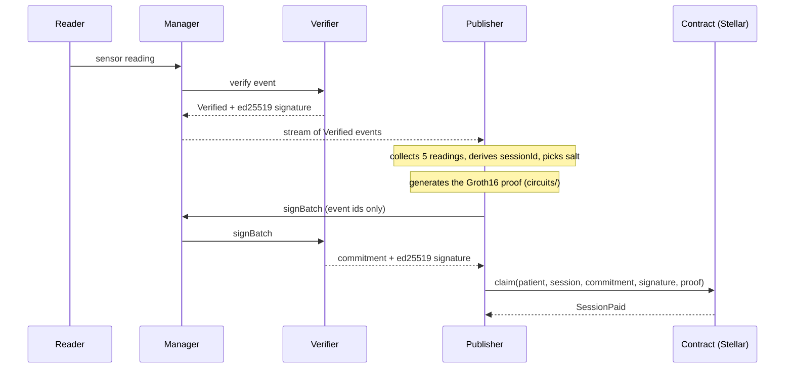
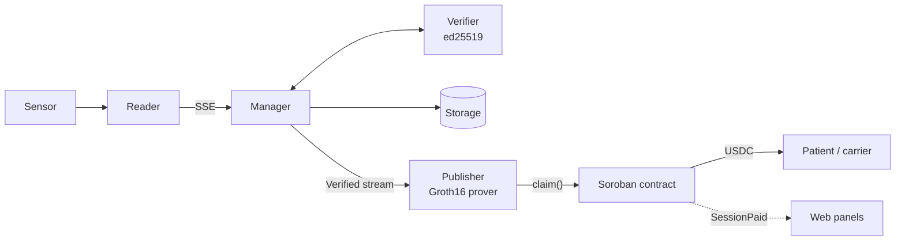

<div align="center">

# 🩺 Phonendo

### Private sensor data · Public ZK proof · Automatic payment on Stellar

Phonendo proves that sensor readings meet a condition **without revealing them**.
A Soroban contract checks the zero-knowledge proof and pays in USDC, automatically.

[](https://phonendo.vercel.app)
[](https://youtu.be/nX8ho0uSeZE)
[](https://stellar.expert/explorer/testnet/tx/084d4e8223cb1a2db2d040920c59b19aa10968352815839e4134836f70fbb1ed)


**HackMeridian 2026 · Lisbon** — Genesis track · Stellar Unlocked & Stellar Composed

[Problem](#-the-problem) · [How it works](#-how-it-works) · [On-chain proof](#-testnet-deployments) · [Quick start](#-quick-start) · [Keys](#-keys) · [Web panels](#-web-panels) · [Security](#-security-and-limits) · [Roadmap](#-roadmap)

</div>

---

## ✨ At a glance

| 🔒 Private | ✅ Verifiable | 💸 Automatic |
| :---: | :---: | :---: |
| Readings never leave the system; only a Poseidon commitment goes on-chain. | A Groth16 proof and an ed25519 Verifier signature are checked inside `claim()`. | The contract pays the patient in USDC and emits `SessionPaid`. |

| 5 | ≥ 4 | 0.1 USDC | 2 |
| :---: | :---: | :---: | :---: |
| readings per session | in range to get paid (rehab) | paid per session on testnet | use cases, one circuit |

---

## 🎯 The problem

**Main use case: cardiac rehabilitation adherence.** An insurer pays the patient a USDC
reward for every completed session. A session counts when the heart rate stayed in the
zone set by the doctor (for example 90-130 bpm) for enough readings.

The insurer only sees "session completed" and the payment, never the heart rate. Health
data is a special category under the GDPR, so it never leaves the system.

The same circuit serves other cases by changing only the policy. In the **cold chain**, a
buyer pays when a shipment stayed inside its temperature range.

| | Cardiac rehabilitation | Cold chain |
| --- | --- | --- |
| Who pays | Insurer | Buyer |
| Who gets paid | Patient | Carrier |
| Policy | 90-130 bpm in at least 4 of 5 readings | 2-8 °C in 5 of 5 readings |
| What goes on-chain | Commitment, policy, session id, result, payment | Same |
| What stays private | Every heart-rate reading | Every temperature reading |

---

## 🧭 How it works



1. **Verify.** The Reader hands each reading to the Manager, which passes it to the
   Verifier. The Verifier checks the event and signs it, and the Manager stores it in
   Storage.
2. **Batch.** The Publisher listens to the Manager's stream and collects 5 Verified
   readings from one device. The `sessionId` is derived from the event ids, so the same
   readings are always the same session and are never paid twice, whatever the number of
   Publishers.
3. **Prove.** Using `circuits/`, it generates a Groth16 proof that at least 4 of the 5
   readings are in range, without revealing them. The proof carries a *commitment*
   (a Poseidon fingerprint of the readings plus a random salt).
4. **Sign the batch.** The Publisher asks the Verifier, through the Manager, to sign the
   batch. It sends only the event ids: the Verifier computes the commitment from the
   readings it verified itself and signs it with ed25519. Whoever gets paid cannot sign
   their own data.
5. **Claim.** `claim()` checks, in order, that the session was not paid before, the
   Verifier's signature, and the proof against the policy stored in the contract. If
   everything is valid it transfers the payment to the patient and emits `SessionPaid`.

> **On-chain data:** only the commitment, the public parameters, the session id, the
> result and the payment. Never readings or personal data.

---

## ⭐ Stellar features used

| Native feature | Where it is used |
| --- | --- |
| Soroban BLS12-381 operations (CAP-59) | `claim()` verifies the Groth16 proof with `pairing_check`. |
| Host ed25519 verification | `claim()` checks the Verifier's signature over `commitment \|\| sessionId \|\| patient account`. |
| Token contract (USDC or XLM) | `claim()` transfers the payment from the contract balance to the patient. |
| Persistent storage with TTL | Each paid session is marked and cannot be paid twice. |
| Contract events | `SessionPaid` announces every payment to the dashboard and explorers. |
| Stellar accounts (`G...`) | The patient's account key is part of the signed message. |

---

## 🔗 Testnet deployments

Rehabilitation policy: 90-130 bpm, at least 4 of 5 readings (5-reading batches). The first claims paid 5
units; each session now pays **0.1 USDC** so the demo can be repeated.

**Latest end-to-end demo (Docker, sequential run):**

| Case | Flow | Payment | Transaction |
| --- | --- | --- | --- |
| Rehabilitation | Simulated heart rate → `claim()` | 0.1 USDC | [`084d4e82…bb1ed`](https://stellar.expert/explorer/testnet/tx/084d4e8223cb1a2db2d040920c59b19aa10968352815839e4134836f70fbb1ed) |
| Cold chain | Simulated temperature → `claim()` | 0.1 USDC | [`a9466f1e…a986`](https://stellar.expert/explorer/testnet/tx/a9466f1ea47b3f0662322988721a5da954487cb31be31bb9d64fae266e90a986) |

**Contracts:**

| Contract | Address |
| --- | --- |
| `adherence`, rehabilitation (5-reading batches, 4 of 5, pays 0.1 USDC per session) | [`CCLQFKRWBLRSPLVAFWBLG22LPRGP3GEV47CGXA6C3VAGPQ2QITE3DNYL`](https://stellar.expert/explorer/testnet/contract/CCLQFKRWBLRSPLVAFWBLG22LPRGP3GEV47CGXA6C3VAGPQ2QITE3DNYL) |
| `adherence`, cold chain (2-8 °C, 5 of 5, pays 0.1 USDC) | [`CACUZG5V45NPFFB5JSLHMTF6NHEP5GMGZ5QJKJPET4ZIRTWOW6VS2VQS`](https://stellar.expert/explorer/testnet/contract/CACUZG5V45NPFFB5JSLHMTF6NHEP5GMGZ5QJKJPET4ZIRTWOW6VS2VQS) |
| `adherence`, rehabilitation, 32-reading batches (retired) | [`CD3ZLDTB7QKJLMAIBSCL75TRHE6IUZ27RW5FLWNB4F3GUQENZZZSM45H`](https://stellar.expert/explorer/testnet/contract/CD3ZLDTB7QKJLMAIBSCL75TRHE6IUZ27RW5FLWNB4F3GUQENZZZSM45H) |
| `adherence`, cold chain, 32-reading batches (retired) | [`CDNPBN6HZP4PZKRFOOA2PYC772KF4THXTJNKHBS5Y33HCAVDWCVO5SRE`](https://stellar.expert/explorer/testnet/contract/CDNPBN6HZP4PZKRFOOA2PYC772KF4THXTJNKHBS5Y33HCAVDWCVO5SRE) |
| `adherence` (pays XLM) | [`CAPZ2O7LPTRGJ2Q7TTHMCHOKRZ4T7KU5I4E74M2U3YUTC3XONIQDOP2D`](https://stellar.expert/explorer/testnet/contract/CAPZ2O7LPTRGJ2Q7TTHMCHOKRZ4T7KU5I4E74M2U3YUTC3XONIQDOP2D) |
| `adherence`, previous version (old signature format, retired) | [`CBF2MBQ6W4S6LD3JSIM3NNZET5KBUKOADRZSKIYZRZBAXRM6OJZCNSFI`](https://stellar.expert/explorer/testnet/contract/CBF2MBQ6W4S6LD3JSIM3NNZET5KBUKOADRZSKIYZRZBAXRM6OJZCNSFI) |
| Testnet USDC issuer | `GBBD47IF6LWK7P7MDEVSCWR7DPUWV3NY3DTQEVFL4NAT4AQH3ZLLFLA5` |

<details>
<summary><b>Milestone transactions</b></summary>

| Milestone | Transaction |
| --- | --- |
| First real claim: ZK proof and signature verified on-chain, 5 XLM | [`891b2fe1…c0aa1`](https://stellar.expert/explorer/testnet/tx/891b2fe1504a9d9c0a34146828e9caac9527a41e3d467eaecf5a994c145c0aa1) |
| USDC contract deployment | [`87b7301d…8beffd`](https://stellar.expert/explorer/testnet/tx/87b7301d2e721070e87a12cfc7aff0927ec53055c4a18ac117cb42441a8beffd) |
| USDC contract funding (20 USDC) | [`f791426c…c4fa`](https://stellar.expert/explorer/testnet/tx/f791426c649045fc02dfbbf7cc69d1b6796292d53da0a4455a6499a0657dc4fa) |
| First real USDC claim: 5 USDC to the patient, `SessionPaid` event | [`0ba0adb7…e78033`](https://stellar.expert/explorer/testnet/tx/0ba0adb7ca42e09350f71eec15c09d252dcfacf13b6cc3672afab8017ce78033) |
| End-to-end claim: simulated heart-rate Reader → Manager → Verifier → Publisher → `claim()`, 5 USDC | [`2a345e9f…06ef47`](https://stellar.expert/explorer/testnet/tx/2a345e9fdf594fc385107a2e1a2e973d3cb16f5274fc14e763bbe9dc0406ef47) |
| Cold-chain claim: simulated temperature Reader → Publisher → `claim()`, 5 USDC | [`639fcfdd…a9efb6`](https://stellar.expert/explorer/testnet/tx/639fcfddd74ddcd1344a26cd1638ac5f66e12a7bc2f69be04da8fb7815a9efb6) |

</details>

---

## 🏗 Architecture

### Services

| Service | Responsibility |
| --- | --- |
| **Reader** | Collects observations and exposes them through an SSE stream. |
| **Manager** | Coordinates the flow, hashes the event content and handles timeout retries. |
| **Verifier** | Validates the event, checks the hash and signs with ed25519 both the verified result and reading batches. |
| **Storage** | Stores verified events and manages its own database. |
| **Publisher** | Batches Verified readings from the Manager, generates the ZK proof and claims the session on Stellar. |




The Manager consumes the Reader's observations over SSE. If the same Reader also sends
events through `/newEvent`, the Manager only accepts the first transport selected for
that Reader (HTTP or SSE) while it runs. Verification supports HTTP or SSE; storage can
use HTTP or Storage subscriptions to the Manager's outputs. The Verifier can also
consume Manager streams and publish results over SSE, and the Manager can subscribe to
them to continue storing. Storage exposes its stream after writing events.

In each JSON config, `stream` is the service's own stream and `subscriptions` lists the
streams it consumes. The Manager uses `outputStreams` for its specific outputs to
Verifiers and Storages, separate from its general `/stream`.

### Sequence


An event is stored only after a positive verification. An explicit rejection discards
it; a timeout keeps it in a temporary in-memory queue for retry. The Publisher only
talks to the Manager (and Stellar) and never contacts the Verifier directly.

### Info and logs

The Python Reader, Manager, Verifier, Storage and Publisher expose, without a token:

| Endpoint | Returns |
| --- | --- |
| `GET /info` | `[{"peer": "...", "transport": "http\|sse"}]`. SSE shows active connections; HTTP shows configured targets or clients seen since start. |
| `GET /logs` | The last 200 in-memory messages, without levels, timestamps or event bodies. Reading them does not create more logs. |

Processing routes keep their authentication. The C++ Reader does not yet have an HTTP
server for these queries.

---

## 🚀 Quick start

Requirements: Docker with Compose.

```sh
docker compose -f deploy/docker/compose.yml up --build -d --wait
```

This builds and starts the five services, including the Publisher. The simulated Reader
emits heart rate first and cold-chain temperature afterwards, each with its own contract
and policy. See [Docker configuration, ports and tests](deploy/docker/README.md).

To claim on testnet, prepare the keys first with `./tools/keys.sh init` (see
[Keys](#-keys)). Without a wallet, the Publisher prepares batches but does not claim.

### Running without Docker

Requirements: Python 3.11 or newer, virtual environment support and `pip`.

Set ports and secrets in `deploy/env/dev.env`, and the connection lists in
`apps/reader/config.json`, `apps/manager/config.json`, `apps/verifier/config.json` and
`apps/storage/config.json`. Then generate the service configs:

```sh
./tools/generate_configs.sh
```

The generator writes each service's `config.env` and the Verifier key.

### Operator console (one command)

```sh
./tools/web.sh
```

Creates any missing keys, builds the web, opens the operator console at `http://127.0.0.1:8080/operator.html`
and lets you deploy, connect and watch every service as a Docker container from the
browser. Requires Docker. See [Web panels](#-web-panels).

> **Windows:** the `tools/*.sh` scripts are Bash. Run them from WSL.

---

## 🔐 Keys

Everything secret lives in [`keys/`](keys/README.md), outside git, managed by one script:

| Key | Used by | Where |
| --- | --- | --- |
| ed25519 signing key | Verifier: signs every event and every batch. It has no wallet. Its public key is the `verifierId` the contract stores. | `keys/verifiers/<name>.json` |
| Stellar wallet | Publisher: sends `claim()` and pays the fees. It signs no data. | `keys/stellar/identity/<alias>.toml` (Stellar CLI format) |

```sh
./tools/keys.sh init                     # creates what is missing: Verifier "dev" and wallet "phonendo"
./tools/keys.sh ls                       # keys and wallets, public parts only
./tools/keys.sh verifier new verifier-b  # another Verifier; prints how to deploy its contract
./tools/keys.sh wallet new publisher-b   # another wallet, funded on testnet
./tools/keys.sh verifier check <contract>  # which of your keys a contract trusts
```

Each contract trusts one Verifier, and a Publisher serves the Verifiers listed in
`contracts` (`{"<verifierId>": "<contract>"}`). For a second Verifier and Publisher pair:
create its key, deploy its contract with that `verifierId` and point the Publisher to its
wallet (`"stellar": {"source": "publisher-b"}`). Docker mounts only the key or wallets
each container needs, read-only.

---

## 💳 Claiming a session

Requires Node.js, `circom` 2.2, Rust and Stellar CLI. Contract steps are in
[contracts](contracts/README.md) and circuit steps in [circuits](circuits/README.md).

```sh
cd circuits && npm install && npm run setup     # once, takes a few minutes
cd .. && ./tools/keys.sh init                   # Verifier key and Publisher wallet
docker compose -f deploy/docker/compose.yml up --build -d --wait
```

The contract must be deployed with the `verifierId` shown by `./tools/keys.sh ls` and with
the same policy as `apps/publisher/config.json`. Check a deployed contract with
`./tools/keys.sh verifier check <contract>`. The Docker simulated Reader emits heart rate
from 95 to 120 bpm and then temperature from 2 to 8 °C (`"simulation": "demo"` in
`deploy/docker/reader.json`). With a real sensor, replace it with the sensor's Reader.

---

## 🔑 Environment variables

| Variable | Where | Purpose |
| --- | --- | --- |
| `STELLAR_SOURCE` | environment | Wallet in `keys/stellar` the Docker Publisher pays with (`phonendo` by default). |
| `VERIFIER_KEY` | environment | Key in `keys/verifiers` the Docker Verifier signs with (`dev` by default). |
| `API_TOKEN_MANAGER`, `API_TOKEN_VERIFIER`, `API_TOKEN_STORAGE` | `compose.yml`, `deploy/env/dev.env` | Tokens between services. The demo values are for demonstration only: change them in any other deployment. |
| `READER_PORT`, `MANAGER_PORT`, `VERIFIER_PORT`, `STORAGE_PORT`, `PUBLISHER_PORT` | environment | Ports published by Docker (7101 to 7105 by default). |
| `WEB_PORT`, `PUBLISHER_CONFIG_PATH` | environment | Local dashboard port (8080) and the Publisher JSON it uses. |

---

## 💻 Web panels

[`apps/web`](apps/web/README.md) is a React app built with Vite (Node.js 20 or newer).
`npm run build` writes static pages to `apps/web/dist` that can be published as they are
on any static host (GitHub Pages, Netlify, Vercel).

**Public demo:** https://phonendo.vercel.app (the operator console only works locally).

**Demo video:** https://youtu.be/nX8ho0uSeZE

| Page | Audience | What it shows |
| --- | --- | --- |
| [`index.html`](apps/web/index.html) | Everyone | Home page linking to the other pages. Each page is independent and can be deployed separately. |
| [`operator.html`](apps/web/operator.html) | Operator | Map of Readers, Managers, Verifiers, Storages and Publishers per organization, health checks and download of their JSON config (same format as `deploy/docker/*.json`). Free canvas with drag & drop, zoom/pan, Auto layout and Fit view. Its top bar has the "Companies" button. |
| [`patient.html`](apps/web/patient.html) | Patient (rehabilitation) | Payments received by a Stellar account, over an ECG background that reacts to each click. |
| [`coldchain.html`](apps/web/coldchain.html) | Carrier (cold chain) | Payments per shipment, a thermometer and corner frost that freezes on click. |
| [`company.html`](apps/web/company.html) | Paying company | Same panel for every use case: total paid, breakdown per use case with its payment rule, and verified payments with their transaction. |

Payments are read in the browser from the `session_paid` events of the public testnet
RPC. If the RPC does not respond, the page says so and shows the already confirmed
transactions. A network edited in the console is saved only in that browser.

### Local start without Docker

```sh
./tools/web.sh                     # creates missing keys and serves the operator
./tools/web.sh --regenerate-keys   # also replaces the wallets with new ones (keeps a backup)
./tools/web.sh --rebuild           # also rebuilds and restarts the Phonendo Docker stack
```

Both options are off by default. Whoever clones the repo only needs to put their keys in
`keys/` (or let `web.sh` create them) and deploy a contract with their `verifierId`. When
deploying a Verifier or a Publisher from the operator, you pick its key or wallet from
`keys/`.

`tools/web.sh` is a Bash script: on Windows, run it with WSL. The payment panels do not
need it and also work with `npm run dev` or `npm run build` in `apps/web`.

When the server responds, it opens two tabs: the operator at
`http://127.0.0.1:8080/operator.html` and Stellar Expert (testnet) with the first contract
in `apps/publisher/config.json`, or the general explorer if none is configured.
`Ctrl+C` stops the web server. The script installs Python 3 if missing (Debian/Ubuntu),
prepares `.venv` with `aiohttp`, builds the web into `apps/web/dist` when `npm` is
available, and warns if Docker Engine or Docker Desktop is not installed.

Change the port with `WEB_PORT=8081 ./tools/web.sh` and pick another JSON with
`PUBLISHER_CONFIG_PATH=deploy/docker/publisher.json ./tools/web.sh`.

The operator served by `tools/web.sh` deploys and manages the services as **Docker
containers**: it builds the images, creates Readers, Managers, Verifiers, Storages and
Publishers, connects them, shows their logs and lets a Reader emit single pulses or
batches of readings. It also detects the containers already started with `compose.yml` (project
`phonendo`). Services keep running after the web is closed. Secrets are masked in the
browser, the control API listens only on loopback and requires the same origin for
actions, and the visual walkthrough only confirms observed steps, never simulating
payments. The web architecture (React providers and consumers) is described in
[apps/web](apps/web/README.md).

---

## 🧪 Tests

Set up the test environment:

```sh
python3 -m venv .venv
.venv/bin/python -m pip install -r tests/requirements.txt
```

Run the component tests and the integration tests against real services:

```sh
./tools/test.sh
./tools/test_integration.sh
```

The C++ Reader tests need a C++17 compiler. The integration test uses temporary ports
and a temporary database, checks streams, signatures and stored-data integrity, and shuts
the services down when it finishes.

---

## 🛡 Security and limits

| Area | Current state |
| --- | --- |
| Trust | The Phonendo Verifier and the sensor are trusted: the Verifier's signature says the readings are the ones it checked. Next step: the sensor signs each reading itself. |
| Trusted setup | The proving-key ceremony (`npm run setup`) has a single participant and is for development only. Production would use a multi-party ceremony. |
| Hash parameters | The circuit uses Poseidon with BN254 constants over the BLS12-381 field. It works and is tested against the circuit, but these are not the standard parameters. |
| Timing | The circuit checks each reading's value and how many are in range, but **not the time between readings**: 5 readings taken within a few seconds count as a session. |
| Availability | The Publisher keeps batches in memory: if it stops, it loses the current batch and does not retry claims. |
| Audit | The contract runs on testnet and is not audited. |
| Secrets | Keys, `config.env` files and local data are not versioned; they are generated with `tools/keys.sh` and `tools/generate_configs.sh`. An old Verifier RSA key and a secret of the `phonendo` wallet remain in the git history and must not be reused. |
| Double claims | The `sessionId` is derived from the batch's events and checked by the Verifier, which also never signs one event in two sessions: the contract never pays the same readings twice, even with several Publishers. |

---

## 📍 Roadmap

1. **On-device signing** of every reading (ESP32), so trust does not rest on a single
   Verifier.
2. **Several Verifiers** and a multi-party key ceremony.
3. **Anchor on-chain** the fingerprint of all verified data, with the data encrypted in
   Storage.
4. **Check the time between readings** in the circuit, so a session lasts as long as it
   should.
5. **Consent registry:** the patient grants or revokes access to their data and the
   contract checks it before Storage releases it.

---

## 📚 Documentation

- Services: [Reader](apps/reader/README.md) · [Manager](apps/manager/README.md) ·
  [Verifier](apps/verifier/README.md) · [Storage](apps/storage/README.md) ·
  [Publisher](apps/publisher/README.md)
- ZK and chain: [ZK circuit](circuits/README.md) · [Soroban contract](contracts/README.md)
- Web: [apps/web](apps/web/README.md)
- Deployment: [Docker](deploy/docker/README.md)
- Diagrams: [editable PlantUML sources](docs/diagramas.md)
