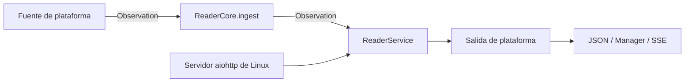

# Phonendo Reader

Reader de Phonendo. La implementación Linux utiliza el core Python y la capa de servidor portable.
También se conserva el core C++ y el runtime Arduino.

El flujo actual está simplificado: la identidad va por `device_id`, no por MAC, y el `serial_manager` solo acepta un formato de mensaje.

## Arquitectura

```text
apps/reader/
├── core/
│   ├── python/reader_core/     # ReaderCore, Device, Sensor, Observation
│   └── cpp/{include,src}/      # El mismo modelo en C++
├── server/
│   ├── python/reader_server/  # Fachada, contratos, ciclo de vida, stream y JSON
│   └── cpp/{include,src}/     # Fachada, puertos de salida y JSON
└── implementations/
    ├── linux/
    │   ├── main.py            # CLI y preparación de rutas
    │   ├── application.py     # Composición Linux
    │   ├── config.py          # Archivos, entorno y construcción de modelos
    │   ├── sources/           # Serial, Bluetooth y métricas del sistema
    │   └── communication/    # aiohttp/SSE y cliente/worker del Manager
    └── arduino/
        ├── platformio.ini
        └── src/               # WiFi, GPIO y cliente/salida HTTP del Manager
```

Las dependencias van desde las implementaciones hacia `server` y desde `server`
hacia `core`. El core puede utilizarse solo. Ningún archivo del core importa
la capa de servidor, librerías HTTP, SDK Arduino ni módulos de la plataforma.



| Capa | Responsabilidad |
| --- | --- |
| `core` | Registro de dispositivos/sensores, creación, validación y emisión de `Observation`. Solo biblioteca estándar. |
| `server` | Fachada `ReaderService`, contratos de fuentes/servidores/salidas, ciclo de vida Python, distribución de eventos y conversión JSON opcional. |
| `implementations/linux` | Configuración, entorno, logging, adquisición y transportes concretos. |
| `implementations/arduino` | Configuración de placa, GPIO, WiFi y entrega HTTP. |

`ReaderService` conecta los callbacks del core con salidas que reciben objetos
`Observation`. En Python se le entrega un core sin callbacks; en C++ lo construye
y lo expone mediante `core()`. Las salidas C++ deben vivir más que el servicio;
una salida asíncrona copia los datos que necesita.

`ReaderRuntime` organiza fuentes (`start/stop`), servidores (`start/stop`) y
workers (`run`). Cancela tareas y libera recursos también ante un fallo parcial
de arranque. No conoce aiohttp, puertos ni tipos de fuente. En C++, `ReaderServer`
define `start/poll/stop` para que cada plataforma gestione su bucle de eventos.
El firmware actual usa la fachada y la salida Manager; no ofrece un servidor
HTTP entrante. La configuración de placa existente es **ESP8266 ESP-12E**;
una implementación ESP32 puede reutilizar core/server y aportar sus adaptadores.

## Flujo Linux

1. `main.py` procesa los argumentos y crea `LinuxReader`.
2. `application.py` carga configuración/entorno e inicializa el logger.
3. Compone `ReaderCore`, `ReaderService`, las salidas y las fuentes habilitadas.
4. `config.py` construye y registra dispositivos/sensores en el core.
5. Las fuentes entregan `Observation` a `ingest()`.
6. El core valida identidades, aplica la política de descubrimiento y emite el objeto.
7. El servicio distribuye el objeto; las salidas convierten a JSON y entregan por
   stream o Manager. El worker del Manager evita bloquear la adquisición.

Para añadir una fuente Linux, implementa el contrato `Source` y añade su
construcción en `implementations/linux/sources/__init__.py`. Las dependencias de
hardware se cargan solo cuando se habilita la fuente correspondiente.

## Comunicación y fuentes configurables

El JSON admite bloques `sources` y `communication`. Las fuentes pueden ser
`serial`, `bluetooth.ble` y `local_metrics`. Cada una se habilita con
`enabled`; sus parámetros quedan en el mismo bloque.
Se siguen aceptando las claves antiguas `serial` y `bluetooth` en la raíz.
Las opciones de `sources` sustituyen al bloque antiguo correspondiente.

La comunicación se configura independientemente:

- `communication.server.enabled`: habilita el servidor HTTP.
- `communication.server.stream_enabled`: habilita el stream SSE.
- `communication.server.host` y `port`: escucha local por defecto en 127.0.0.1:3002.
- `communication.server.token`: token Bearer; alternativamente `API_TOKEN_READER`.
  Si ambos están vacíos, el servidor permite acceso sin autenticación.
- `communication.manager.enabled`: habilita la salida hacia un manager.
- `communication.manager.url` y `token`: destino y credenciales; por defecto
  usa `INTERNAL_URL_MANAGER` y `API_TOKEN_MANAGER`.
- `communication.manager.register_devices` y `send_observations`: activan
  por separado el registro de dispositivos y el envío.

Si no existe `communication`, se conserva el envío al manager de la configuración
anterior. Si existe, servidor y manager están deshabilitados salvo activación
explícita. Ambos pueden funcionar simultáneamente. El registro remoto se ejecuta
en el worker de comunicación, no durante la construcción del Reader.
Las variables del entorno del proceso prevalecen sobre `config.env`.

Endpoints iniciales del servidor (contrato local, pendiente de especificación
global del protocolo):

| Método y ruta | Resultado |
| --- | --- |
| `GET /health` | Estado del servicio |
| `GET /metadata` | Identidad y capacidad de streaming |
| `GET /devices` | Dispositivos conocidos y sus identificadores de sensores |
| `GET /observations/stream` | Stream SSE de observaciones |

Cada evento SSE `observation` contiene JSON con `readerId`, `deviceId`,
`eventType`, `payloadFormat: "application/json"` y un objeto JSON en `payload`. El payload conserva el
identificador de la observación. Cada consumidor recibe su propia copia.

Para probar un reader autónomo con métricas locales:

```sh
python3 -m pip install -r apps/reader/implementations/linux/requirements.txt
python3 apps/reader/implementations/linux/main.py --config stream.example.json
curl -N http://127.0.0.1:3002/observations/stream
```

El stream es en vivo: no persiste eventos ni permite recuperar los perdidos
durante una desconexión. Cada consumidor tiene una cola limitada por
`server.queue_size` (256 por defecto); si se llena, se descarta su cola y se
cierra esa suscripción con el evento `stream_closed`. Los demás continúan.

La salida al manager utiliza otra cola y ejecuta HTTP fuera del bucle de
captura. Registra cada dispositivo antes de enviar sus observaciones cuando
el registro está habilitado. Los errores de entrega y los desbordamientos
quedan en el log; no hay persistencia ni reintento de observaciones fallidas.
Una inscripción fallida se vuelve a intentar al enviar la siguiente observación.
Al detener el reader se cierran las fuentes y el servidor; los eventos
pendientes en memoria no se conservan.

## Configuración

Ejemplo:

```json
{
  "serial": {
    "glob": "/dev/rfcomm*",
    "baudrate": 9600,
    "read_timeout": 1.0,
    "poll_seconds": 1.0,
    "reconnect_seconds": 2.0
  },
  "devices": [
    {
      "comm": "/dev/rfcomm1",
      "device_id": "prueba2",
      "allow_conflicts": false
    }
  ],
  "sensors": [
    {
      "sensor_id": "temp1",
      "device_id": "prueba2",
      "observable_property": "temperatura",
      "procedure": "termorreceptor",
      "feature_of_interest": "patient-001",
      "unit": "CELSIUS",
      "allow_conflicts": false
    }
  ]
}
```

### `serial`

- `glob`: patrón de puertos a descubrir. Por defecto `/dev/rfcomm*`.
- `ports`: lista opcional de puertos permitidos. Si se define, filtra los puertos encontrados por `glob`.
- `baudrate`: velocidad del puerto serie.
- `read_timeout`: timeout de `readline()`.
- `poll_seconds`: cada cuánto se revisa si hay puertos nuevos.
- `reconnect_seconds`: espera antes de reintentar tras error de lectura.

### `devices`

- `device_id`: identificador lógico del dispositivo.
- `comm` o `com`: puerto serie asociado, por ejemplo `/dev/rfcomm1`.
- `allow_conflicts`: permite aceptar un `device_id` distinto al configurado para ese puerto.
- `static`: si es `true`, no permite sensores nuevos en ese dispositivo.

### `sensors`

- `sensor_id`: identificador del sensor.
- `device_id`: opcional. Si se define, el sensor queda ligado al device y al puerto configurado para ese device. Si no se define, el sensor es portable y puede llegar por cualquier puerto.
- `observable_property`: propiedad observada.
- `procedure`: procedimiento de medición.
- `feature_of_interest`: entidad observada.
- `unit`: unidad opcional.
- `allow_conflicts`: permite aceptar un `sensor_id` distinto al configurado para ese puerto.

## Formato De Mensaje Serie

Se aceptan dos entradas:

- Valor crudo en una línea.
- JSON con claves `snake_case`.

Si llega una línea que no es JSON, se interpreta automáticamente como `value`.

Valor crudo:

```text
83.4
```

Equivale a:

```json
{"value":"83.4"}
```

Mensaje mínimo:

```json
{"value":"45.3"}
```

Mensaje completo:

```json
{
  "device_id": "prueba2",
  "sensor_id": "temp1",
  "value": "45.3",
  "observable_property": "temperatura",
  "procedure": "termorreceptor",
  "feature_of_interest": "patient-001",
  "unit": "CELSIUS"
}
```

Claves permitidas:

```text
device_id
sensor_id
value
observable_property
procedure
feature_of_interest
unit
```

En JSON, todo lo demás se descarta. No se aceptan:

- `deviceId`, `sensorId`, `observableProperty`, etc.
- `sensor:valor`.
- JSON sin `value`.
- claves extra.

## Cómo Funciona `serial_manager`

`SerialDeviceManager` tiene dos bucles:

- `_watch_loop()`: descubre puertos periódicamente con `glob`.
- `_reader_loop(port)`: abre cada puerto y espera líneas con `serial_port.readline()`.

Descubrimiento:

```python
ports = sorted(glob.glob(self.port_glob))
```

Lectura:

```python
raw = await asyncio.to_thread(serial_port.readline)
```

Esto significa:

- El descubrimiento de puertos es por polling cada `poll_seconds`.
- La lectura de datos no es polling; una vez abierto el puerto, queda esperando una línea.
- Si el puerto aparece y manda datos antes de que el watcher lo abra, esos primeros datos podrían perderse.

Cuando llega una línea:

```text
bytes -> JSON -> Observation -> LinuxReader.ingest()
```

## Sensores Portables Y Conflictos

El parser primero asigna contexto usando el puerto, el `sensor_id` recibido y la configuración.

Un sensor sin `device_id` es portable:

```json
{
  "sensor_id": "temp1",
  "observable_property": "temperatura",
  "procedure": "termorreceptor"
}
```

Puede llegar por `/dev/rfcomm0`, `/dev/rfcomm1` o cualquier puerto escuchado. Si además es el único sensor portable configurado, también puede aceptar valores crudos como:

```text
45.3
```

Un sensor con `device_id` queda ligado al puerto del device:

```json
{
  "sensor_id": "temp1",
  "device_id": "prueba2",
  "observable_property": "temperatura",
  "procedure": "termorreceptor"
}
```

Si `prueba2` está configurado en `/dev/rfcomm1`, ese sensor no se acepta por `/dev/rfcomm9`.

Después de asignar el contexto, el parser compara el mensaje con la configuración.

Si el puerto está configurado con:

```json
{
  "comm": "/dev/rfcomm1",
  "device_id": "prueba2",
  "allow_conflicts": false
}
```

Y llega:

```json
{"device_id":"otro","value":"45.3"}
```

La medición se descarta.

Para permitirlo:

```json
{"allow_conflicts": true}
```

Para sensores pasa lo mismo con `allow_conflicts` dentro del sensor configurado. Internamente se guarda como política para `sensor_id`, semántica y unidad.

## Fallback

Si falta `device_id` en el mensaje:

1. Se usa el `device_id` configurado para el puerto.
2. Si no hay dispositivo configurado, el mensaje debe incluir `device_id`; nunca se sustituye por `reader_id`.

Si falta `sensor_id`:

1. Se usa el `sensor_id` configurado para el puerto.
2. Si no hay sensor único configurado para ese puerto, se usa el nombre del puerto.

Si el `Device` o el `Sensor` no existen y el Reader no está en modo `static`, se crean con los metadatos disponibles.

## Uso

Desde la raíz del repo:

```bash
python3 apps/reader/implementations/linux/main.py
```

Con configuración explícita:

```bash
python3 apps/reader/implementations/linux/main.py --config apps/reader/implementations/linux/devices_and_sensors.json
```

Con identificador de Reader:

```bash
python3 apps/reader/implementations/linux/main.py --reader-id reader-1
```

Modo estático:

```bash
python3 apps/reader/implementations/linux/main.py --static
```

En modo estático no se crean dispositivos ni sensores que no estén en la configuración.

## Variables De Entorno

Se cargan desde `apps/reader/config.env`.

- `API_TOKEN_MANAGER`: token usado al enviar eventos.
- `INTERNAL_URL_MANAGER`: URL base del Manager.
- `PHONENDO_LOGS_DIR`: carpeta de logs.
- `PHONENDO_VERBOSE`: logs detallados si es verdadero.
- `PHONENDO_LOGGING`: activa/desactiva logging.
- `PHONENDO_DEV`: modo dev del logger.

## BLE

`bluetooth_manager` queda separado del flujo serie. Solo escanea BLE si se configura explícitamente:

```json
{
  "bluetooth": {
    "ble": {
      "enabled": true,
      "scan_timeout_seconds": 2.0,
      "sleep_seconds": 0.5
    }
  }
}
```

También emite `Observation`; no hay clases paralelas tipo `BluetoothObservation`.

## Observaciones

La única clase de medición que circula por el Reader es:

```python
reader_core.observation.Observation
```

Campos:

- `observable_property`
- `simple_result`
- `phenomenon_time`
- `feature_of_interest`
- `procedure`
- `device_id`
- `sensor_id`
- `unit`
- `observation_id`

No se usa MAC para identificar dispositivos. La identidad se resuelve por `device_id`.

## Ejemplo Con Arduino/RFCOMM

Si Arduino manda por Bluetooth serie a `/dev/rfcomm1`, debe enviar una línea JSON terminada en salto de línea:

```text
36.7
```

O como JSON mínimo:

```text
{"value":"36.7"}
```

O completa:

```text
{"device_id":"prueba2","sensor_id":"temp1","value":"36.7","observable_property":"temperatura","procedure":"termorreceptor","feature_of_interest":"patient-001","unit":"CELSIUS"}
```

El salto de línea importa porque la lectura se hace con `readline()`.

## Formato de salida de las observaciones

Python y C++ envían los mismos campos de observación en JSON. El cliente del
Manager envía este objeto dentro de `payload`, sin convertirlo en una cadena:

```json
{
  "eventType": "observation",
  "readerId": "reader-1",
  "deviceId": "prueba2",
  "payloadFormat": "application/json",
  "payload": {
    "observation_id": "obs-1",
    "device_id": "prueba2",
    "sensor_id": "temp1",
    "observable_property": "temperatura",
    "simple_result": "36.7",
    "phenomenon_time": "2026-10-22T10:00:00+00:00",
    "feature_of_interest": "patient-001",
    "procedure": "termorreceptor",
    "unit": "CELSIUS"
  }
}
```

El cliente añade también el token del Manager. Los identificadores conservan su
valor original. Python conserva el tipo de `simple_result`; en el modelo C++
este campo es una cadena. Una unidad ausente es `null` en Python o una cadena
vacía en C++. Los callbacks del core reciben `Observation` (en C++, `const Observation&`).
Linux y Arduino convierten la observación a JSON en sus adaptadores de salida.

## API del core

`ingest(observation)` registra dispositivos/sensores nuevos cuando lo permiten
`allow_new_devices` y `allow_new_sensors`, y emite la observación original.
`device_id` y `sensor_id` son obligatorios: el core no inventa identidades ni
sustituye metadatos vacíos por `unknown`. Las fuentes completan los metadatos
que conozcan antes de llamar al core.

```python
core = ReaderCore(reader_id="reader-01", on_observation=output)
core.register_device(device)
observation = core.create_observation(
    device_id=device.device_id, sensor_id="temp1", value=24.6,
)
core.ingest(observation)
```

`create_observation()` solo construye; `ingest()` emite. El callback
`on_register_device` recibe únicamente `Device`. La salida añade el `reader_id`
y realiza la serialización. Sin callbacks, el core también funciona.
En C++, los equivalentes son `createObservation(..., &observation)`,
`ingest(observation)` y `setOnObservationCallback(callback)`.
El puntero de observación del callback C++ solo es válido durante la llamada;
una salida asíncrona debe copiarla. Para configuración sin `device_id`, solo
se admite un `default_device_id` explícito.

## Migración y comprobaciones

- El arranque Linux está en `implementations/linux/main.py`; `tools/dev.sh` ya usa esa ruta.
- Las fuentes usan `ingest()`; se han eliminado `handle_serial_data` y `handle_bluetooth_data`.
- La carga de modelos está en `implementations/linux/config.py`, fuera del core.
- La serialización está en `reader_server.serialization.observation_to_dict()`
  y `observationToJson()` (`reader_serialization.h`), fuera de `Observation`.
- `apps/reader/config.env` conserva su ubicación. Las rutas relativas de JSON se
  resuelven desde el directorio actual o desde la implementación Linux.

Uso del core Python sin Linux ni servidor:

```sh
PYTHONPATH=apps/reader/core/python python3 -c 'from reader_core import ReaderCore; print(ReaderCore("example").reader_id)'
```

Pruebas de contrato, independencia de capas y transportes:

```sh
python3 -m pytest tests/app_tests/test_reader*.py -q
pio run -d apps/reader/implementations/arduino
```

Las pruebas C++ usan `g++` y también compilan el core con `ARDUINO` definido
sin proporcionar ningún SDK. La compilación PlatformIO verifica los adaptadores
reales de ESP8266, sin flashear el dispositivo. Python conserva tipos JSON nativos
en los valores; el modelo C++ conserva su representación de valores como cadenas.
