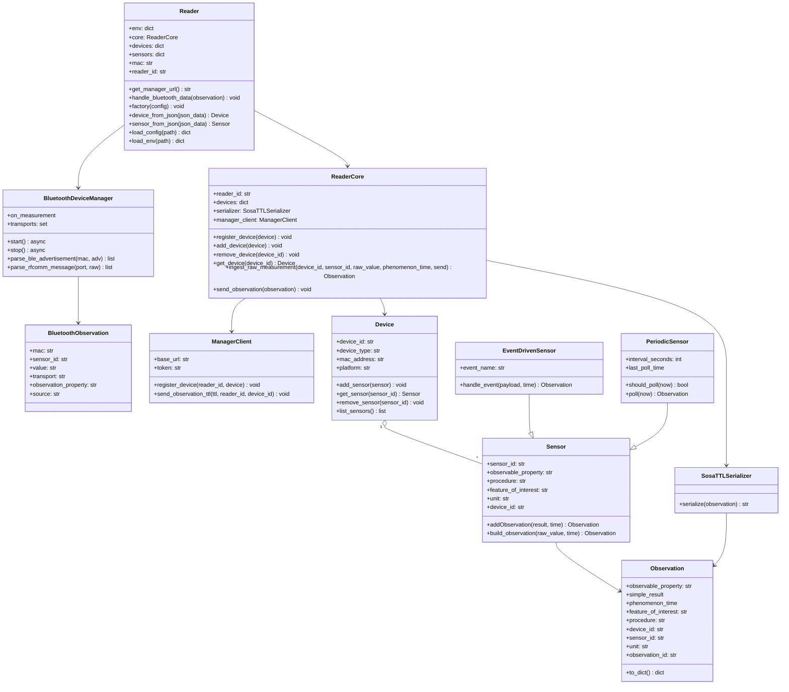
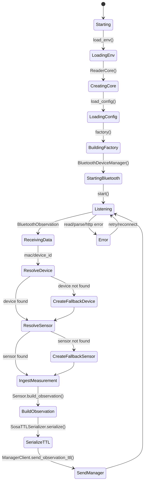
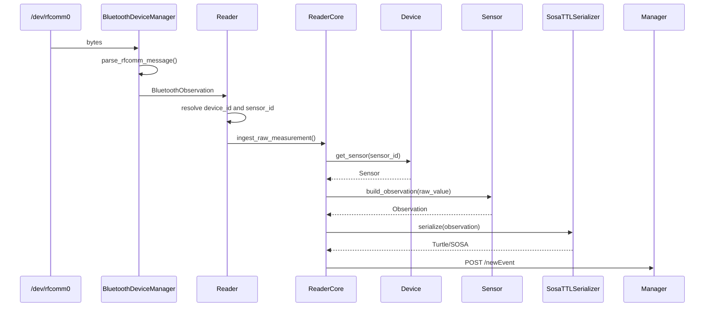

# Phonendo Python Reader

Este módulo implementa el Reader Python de Phonendo. Su responsabilidad es recibir datos crudos desde fuentes externas, asociarlos a un dispositivo y sensor conocidos, construir una observación semántica y enviarla al Manager.

El Reader actual está pensado para trabajar principalmente con sensores Bluetooth/RFCOMM o puertos serie, usando una configuración previa en `devices_and_sensors.json`.

## Estructura

```text
apps/reader/python/
├── main.py
├── devices_and_sensors.json
├── bluetooth_manager/
│   ├── __init__.py
│   └── bluetooth_manager.py
└── reader_core/
    ├── core.py
    ├── device.py
    ├── observation.py
    ├── sensor.py
    └── serializer.py
```

## Flujo General

1. `Reader` carga variables de entorno desde `config.env`.
2. `Reader` crea un `ReaderCore`.
3. `Reader` carga `devices_and_sensors.json`.
4. `Reader.factory()` crea los `Device` y `Sensor` definidos en configuración.
5. `BluetoothDeviceManager` escucha datos Bluetooth/RFCOMM.
6. Cada dato recibido llega a `Reader.handle_bluetooth_data()`.
7. El Reader busca el `Device` y `Sensor`.
8. `ReaderCore.ingest_raw_measurement()` crea una `Observation`.
9. `SosaTTLSerializer` convierte la observación a Turtle/SOSA.
10. `ManagerClient` envía la observación al Manager por HTTP.

## Configuración De Dispositivos Y Sensores

El archivo `devices_and_sensors.json` define qué dispositivos y sensores conoce el Reader antes de empezar a recibir datos.

Ejemplo actual:

```json
{
  "devices": [
    {
      "comm": "/dev/rfcomm0",
      "mac": "00:21:13:01:1F:91",
      "device_id": "prueba1"
    }
  ],
  "sensors": [
    {
      "sensor_id": "temp1",
      "procedure": "termorreceptor",
      "observable_property": "temperatura",
      "device_id": "prueba1"
    }
  ]
}
```

Campos de `devices`:

- `device_id`: identificador lógico del dispositivo dentro de Phonendo.
- `mac`: MAC real, MAC configurada o MAC pseudónima del dispositivo.
- `device_type`: tipo de dispositivo. Si no se indica, se usa `"bluetooth"`.
- `platform`: plataforma opcional.
- `comm`: fuente de comunicación local, por ejemplo `/dev/rfcomm0`.

Campos de `sensors`:

- `sensor_id`: identificador del sensor dentro del dispositivo.
- `device_id`: dispositivo al que pertenece el sensor.
- `observable_property`: propiedad observada, por ejemplo `"temperatura"`.
- `procedure`: procedimiento de medición.
- `feature_of_interest`: entidad observada. Si no se indica, se usa `"unknown-feature"`.
- `unit`: unidad opcional, por ejemplo `"CELSIUS"`.

## Clases Principales

### Reader

Definida en `main.py`.

Es la clase de orquestación del Reader. Carga configuración, mantiene el registro local de dispositivos y sensores, recibe datos Bluetooth y delega el procesamiento semántico en `ReaderCore`.

Atributos principales:

- `env`: variables leídas desde `config.env`.
- `core`: instancia de `ReaderCore`.
- `devices`: diccionario `device_id -> Device`.
- `sensors`: diccionario `sensor_id -> Sensor`.
- `mac`: MAC del Reader o MAC fallback.
- `reader_id`: identificador del Reader.
- `config_file`: archivo de configuración usado para dispositivos y sensores.

Métodos:

- `get_manager_url()`: resuelve la URL base del Manager.
- `handle_bluetooth_data(observation)`: recibe una `BluetoothObservation`, crea fallback si no existe device/sensor, e ingiere la medición.
- `factory(config)`: crea dispositivos y sensores desde el JSON de configuración.
- `device_from_json(json_data)`: construye un `Device`.
- `sensor_from_json(json_data)`: construye un `Sensor`.
- `load_config(path)`: lee un archivo JSON de configuración.
- `load_env(path)`: lee un archivo `.env` simple.

### BluetoothDeviceManager

Definida en `bluetooth_manager/bluetooth_manager.py`.

Gestiona la lectura de datos Bluetooth. Actualmente soporta:

- `BLE`: escaneo de advertisements BLE.
- `RFCOMM`: lectura de puertos serie `/dev/rfcomm*`.

Produce objetos `BluetoothObservation`.

Formatos RFCOMM soportados:

```json
{"sensor_id": "temp1", "value": "24.5"}
```

```text
temp1:24.5
```

```text
24.5
```

Si el mensaje no incluye `sensor_id`, se usa el sensor configurado para el puerto o el propio nombre del puerto.

### BluetoothObservation

Representa una medición recibida por Bluetooth.

Campos:

- `mac`: MAC asociada al dispositivo remoto. Puede venir de configuración.
- `sensor_id`: sensor que produjo el dato.
- `value`: valor recibido.
- `transport`: `"BLE"` o `"RFCOMM"`.
- `observation_property`: propiedad observada si el origen la indica.
- `source`: fuente local, por ejemplo `/dev/rfcomm0`.

### ReaderCore

Definida en `reader_core/core.py`.

Contiene la lógica principal de registro, ingestión y envío de observaciones.

Atributos:

- `reader_id`: identificador del Reader.
- `devices`: dispositivos registrados en memoria.
- `serializer`: instancia de `SosaTTLSerializer`.
- `manager_client`: cliente HTTP para comunicarse con el Manager.

Métodos:

- `register_device(device)`: registra un dispositivo localmente y en el Manager.
- `add_device(device)`: registra un dispositivo solo en memoria.
- `remove_device(device_id)`: elimina un dispositivo local.
- `get_device(device_id)`: recupera un dispositivo.
- `ingest_raw_measurement(device_id, sensor_id, raw_value, phenomenon_time, send)`: transforma un valor crudo en observación.
- `send_observation(observation)`: serializa y envía una observación.

### ManagerClient

Definida en `reader_core/core.py`.

Encapsula las llamadas HTTP al Manager.

Métodos:

- `register_device(reader_id, device)`: envía `/registerDevice`.
- `send_observation_ttl(ttl, reader_id, device_id)`: envía `/newEvent`.

### Device

Definida en `reader_core/device.py`.

Representa una fuente física o lógica de datos. Un `Device` aloja uno o más sensores.

Atributos:

- `device_id`
- `device_type`
- `mac_address`
- `platform`
- `_sensors`

Métodos:

- `add_sensor(sensor)`
- `get_sensor(sensor_id)`
- `remove_sensor(sensor_id)`
- `list_sensors()`
- `has_sensor(sensor_id)`
- `sensor_count()`

### Sensor

Definida en `reader_core/sensor.py`.

Representa un sensor lógico dentro de un dispositivo.

Atributos:

- `sensor_id`
- `observable_property`
- `procedure`
- `feature_of_interest`
- `raw_adapter`
- `unit`
- `device_id`

Métodos:

- `addObservation(_simple_result, _phenomenom_time)`: crea una `Observation`.
- `build_observation(raw_value, phenomenon_time)`: crea una observación a partir de un valor crudo.

Actualmente `Sensor` no aplica validación específica al valor recibido. Solo lo encapsula en una observación usando la configuración disponible.

### Observation

Definida en `reader_core/observation.py`.

Representa una observación generada por un sensor.

Campos:

- `observable_property`
- `simple_result`
- `phenomenon_time`
- `feature_of_interest`
- `procedure`
- `device_id`
- `sensor_id`
- `unit`
- `observation_id`

Métodos:

- `to_dict()`: devuelve una representación JSON simple.

### SosaTTLSerializer

Definida en `reader_core/serializer.py`.

Convierte una `Observation` en RDF/Turtle usando SOSA.

Genera recursos para:

- `sosa:Platform`
- `sosa:Sensor`
- `sosa:ObservableProperty`
- `sosa:FeatureOfInterest`
- `sosa:Procedure`
- `sosa:Observation`

## Diagrama De Clases



## Diagrama De Estados Del Reader



## Diagrama De Secuencia De Una Medición RFCOMM



## Políticas Actuales

### Dispositivo configurado

Si el dispositivo existe en `devices_and_sensors.json`, se crea al arrancar y se registra localmente.

### Sensor configurado

Si el sensor existe en `devices_and_sensors.json`, se crea al arrancar y se enlaza con su `Device`.

### Dispositivo no configurado

Si llega una observación con una MAC desconocida, `handle_bluetooth_data()` crea un `Device` básico:

```text
device_id = observation.mac
device_type = bluetooth
mac_address = observation.mac
```

Si `observation.mac == "unknown"`, se usa la MAC fallback del Reader.

### Sensor no configurado

Si llega un `sensor_id` no registrado, se crea un `Sensor` básico:

```text
observable_property = observation.observation_property or "Unknown"
procedure = configured-measurement
feature_of_interest = unknown-feature
unit = None
```

Este fallback permite no perder el dato, pero la calidad semántica es limitada.

## Limitaciones Actuales

El Reader actual cubre bien el caso:

```text
sensor simple + configuración previa
```

Todavía no cubre completamente:

- Handshake de autodescripción del dispositivo.
- Mensajes `hello` con lista de sensores.
- Persistencia de dispositivos descubiertos dinámicamente.
- Resolución automática fiable de MAC remota desde `/dev/rfcomm0`.
- Validación específica por tipo de sensor.
- Diferenciación fuerte entre MAC física, MAC configurada y MAC pseudónima.

## Futuras Extensiones

Extensiones razonables:

- Soportar mensajes de autodescripción:

```json
{
  "type": "hello",
  "device_id": "arduino-01",
  "mac": "00:21:13:01:1F:91",
  "sensors": [
    {
      "sensor_id": "temp1",
      "observable_property": "temperatura",
      "procedure": "termorreceptor",
      "feature_of_interest": "patient-001",
      "unit": "CELSIUS"
    }
  ]
}
```

- Añadir política explícita para identidades:

```text
configured > handshake > transport_discovery > pseudonymous > unknown
```

- Guardar en cada device el origen de identidad:

```text
configured
handshake
transport
pseudonymous
fallback
```

- Permitir que un sensor desconocido quede en estado pendiente si no hay semántica suficiente.

## Ejecución

El entrypoint actual es:

```bash
python apps/reader/python/main.py
```

Actualmente `Reader.__init__` es asíncrono, pero se invoca directamente al final de `main.py`. Para ejecución real debería ajustarse a un patrón con `asyncio.run()` cuando se estabilice el arranque.

## Resumen

El Reader Python actual es una base configurable para recibir datos por Bluetooth/RFCOMM, asociarlos a dispositivos y sensores, construir observaciones y enviarlas al Manager. La configuración previa es el mecanismo principal para dar semántica a sensores simples. Los sensores no configurados se aceptan mediante fallback, pero con semántica mínima.
