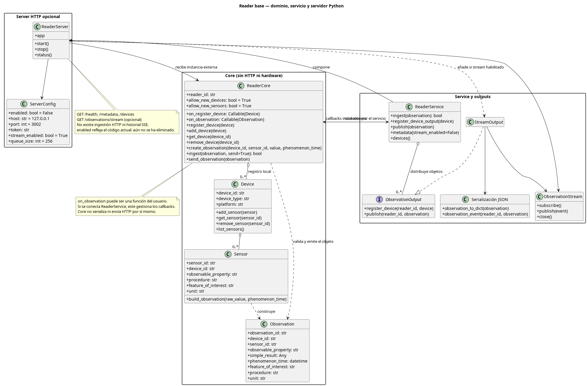
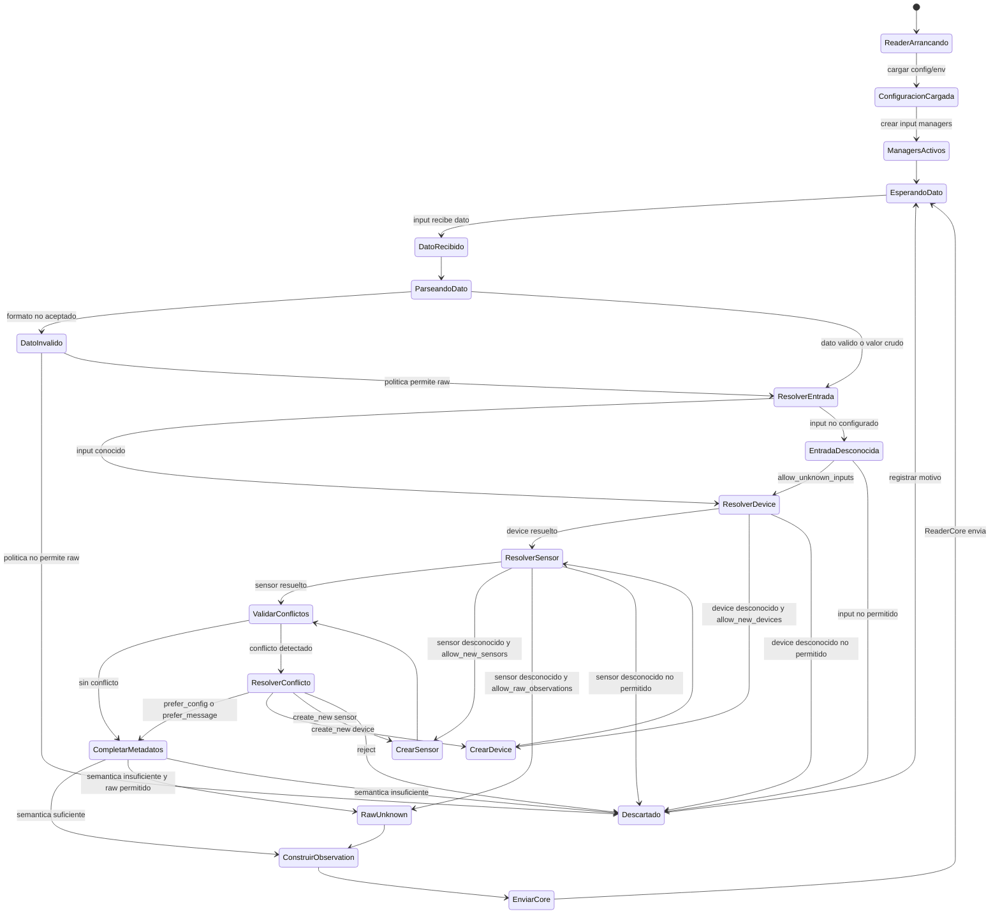
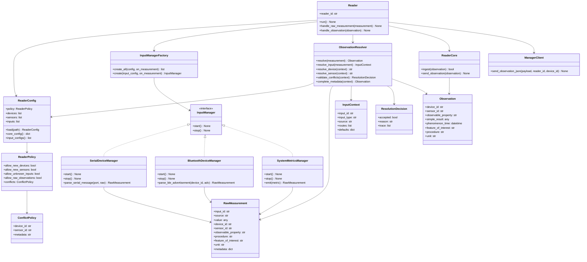

> Estado del Reader: este documento contiene propuestas históricas. La arquitectura
> implementada de python/cpp/examples y sus instrucciones de ejecución
> están en [Reader](../apps/reader/README.md#arquitectura).

# PHONENDO 

- `author`: Jose Luis Parrilla Fuentes 
- `email`: jlpf0006@red.ujaen.es


# 1. Introducción 

Phonendo es una plataforma diseñada para manejar datos generados por dispositivos portatiles, basado en una arquitectura de basada en microservicios modular.

La propuesta inicial de phonendo definía una arquitectura distribuida compuesta por distintos servicios, los cuales incluyen los `Reader`, los `Manager`, los `Storage`, los `Verfier` y los `Publisher`. El proposito de esta arquitectura es capturar los datos de los dispositivos portatiles, verificar la integridad y la proveniencia de los datos, y la posterior publicación confiable en una infraestructura segura.

En esta nueva actualización, el `Reader` recive datos brutos de sensores locales o conectados por bluetooth, estandarizados mediante una ontología común.
Enviar las observaciones estructuradas al `Manager` usando comunicaciones basadas en HTTP. Este diseño permite a Phonendo soportar un amplio despliegue de sensores y escenarios. 

El objetivo final es contruir un robusto , extensible y fácilmenete desplegable sistema que pueda servir para futuras implementaciones de Phonendo. 


# 2. Objetivos

El objetivo principal de este proyecto es diseñar e implementar Phonendo de forma que seacapaz de correr en disposivitos portatiles mientras soporta una variedad de sensores y mecanismos de comunicación. 

Para lograr esta meta, he definido los siguientes objetivos concretos.

## 2.1. Construir un Reader compatible

Desarrollar un Reader ligero que pueda ser ejectutado y formar la entrada de los sensores. 

El reader debe de ser capaz de: 

- Obtener datos de los sensores conectados al dispositivo.
- Soportar sensores locales y conectador por bluetooth. 
- Manegar distintos dispositivos conectados al mismo Reader.
- Soportar dispositivos con multimples sensores. 
- Enviar información estandarizada al `Manager` a través de comunicaciones HTTP 


## 2.2. Definir una ontología común


Diseñar o adoptar una ontología común que provea una estandarización para representar la información relacionada de los sensores.


Esta ontología debe ser capaz de describir: 


- Dispositivos.
- Sensores.
- Observaciones en bruto.
- Unidades de medida.
- Marcas de tiempo.
- Método de adquisición del sensores.
- Lecturas periodicas .
- Lecturas por eventos.
- Proveniencia de los datos.


La ontología debería estar lo  más estandarizada posible para mejorar la interoperabilidad con modelos semánticos existentens y futuras extensiones de la plataforma.

## 2.3. Ind `phonendoSensors` library

Create a dedicated library, named `phonendoSensors`, responsible for acting as an abstraction layer between physical sensors and the Reader.

This library should provide a unified interface for interacting with different types of sensors, regardless of whether they are local sensors, Bluetooth devices, or future sensor integrations.

Its responsibilities include:

- Reading data from supported sensors.
- Normalizing raw sensor outputs.
- Applying sensor-specific configurations.
- Exposing a common interface to the Reader.
- Supporting both periodic and event-based sensors.


## 2.4. Proveer herramientas de despliegue y entorno


Construir las herramientas necesarias para simplicar el despligue de Phonendo tanto como sea posible. 

Esto incluye :

- Archivos de configuración.
- Scripts de Despliegue.
- Contenedores de cada servicios.
- Ejemplos y tutoriales.

## 2.5. Asegurar rosbustez y escabilidad

La plataforma debe de ser capaz de:

- Seguir operando aunque falle un servicio individual.
- Soportar multiples microservicios operando independientemente.
- Poder integrar una gran cantidad de sensore.
- Mantener los datos consistentes en todo el ciclo de datos. 


# 3. Arquitectura general



# 4. Ciclo de vida
    Un dato en bruto es recodigo por un sensor, el cual se encuentra en un dispositivo
    dicho dispositivo envía los datos en bruto al reader , el reader estandariza lo recibido y lo envía al manager.

    1. Identificación del dispositivo en la observación
    2. Recepción de datos
    3. Procesamiento de datos + Storage -> estado "Captured"
    4. Verification
    5. Storage -> estado "Verified"
    6. Publication
    7. Storage -> estado "Published" / fin del ciclo
    

    El Manager coordina la verificación; Storage organiza y guarda los eventos verificados.
# 5. Ontology
    una ontología común que comunique 


# 6. Comunitation details 

# 7. Proyect 

# 8. Examples and tutorials

# 9. Desing decisions
    Un dispositivo es contiene una MAC y sensores 
    el disposiutivo es identificado por su MAC 
# 10. References 

La idea del reader es que vaya dentro del dispositivo portatil , 

El reader se ejecutará en dicho dispositivo y mediante http envería al manager los datos de los sensores recogidos

Se hace necesaria una ontología común universal para poder trabajar con todo tipo de sensores y que el reader lo entienda


Entonces la librería phonendoSensors Sería la encargada de posicionarse entre el los sensores y el reader 

El reader debe de tener disponibles configuraciones para todo tipo de sensores y también limitaciones por parte del manager

El reader debe gestionar :
        Sensores concretos: Sensores que se disparan en ciertos eventos concretos
        Sensores periodicos: Sensores que siempre están enviadno información 
            - intervalos de timepo , tiemouts etc etc

Todo esto debe ser configurable por el reader 

También phonendo debe ser reescrito en rust y entender dicha ontología 


La libería también debe de gestionar , sensores por bluetooth , y locales 


El texto dice que el Manager tiene entre sus responsabilidades certificar los datos y la procedencia; para eso, cada mensaje se firma con una clave asociada al wearable, generada usando la MAC del wearable y una contraseña del Manager mediante SHA256

.

Después, en la parte de Verifier, dice que el Verifier valida la integridad del dato usando heurísticas y genera como resultado un mensaje firmado que timestampa el dato capturado; por ejemplo, comprueba rangos permitidos y timestamps antiguos .


# Esquema  de schema.org

 La intención es tener un esquema que sirva de lenguaje común para la comunicación de todos los sensores 
https://schema.org/docs/iot-gettingstarted.html


Más enlaces sobre ontologías

La principal y recomendada:
https://www.w3.org/ns/sosa/ → SOSA (Sensor, Observation, Sample, and Actuator)
Esta es el núcleo ligero y más usado para describir cualquier tipo de sensor y sus observaciones.

Versión completa:
https://www.w3.org/ns/ssn/ → SSN (Semantic Sensor Network Ontology)

Documentación oficial:
https://www.w3.org/TR/vocab-ssn/ (especificación SSN)
https://www.w3.org/TR/vocab-ssn-2023/ (edición más reciente)


Estandart de sensores para proveer de significado a las anotaciones de los sensores:
 https://www.ogc.org/standards/om/

http://portal.opengeospatial.org/files/55939


Docunentación de owl: https://www.w3.org/2007/09/OWL-Overview-es.html


Protegé  software para crear ontologías: https://protege.stanford.edu/

RDF  para mierdas
https://www.w3.org/RDF/
https://www.seofreelance.es/que-es-rdf-introduccion-a-rdf/


https://rdflib.readthedocs.io/en/stable/

https://www.w3.org/TR/owl-time/#time:TemporalEntity

plyvel referencia para la base de datos: https://plyvel.readthedocs.io/en/latest/ 


Claro. Te dejo una anotación ordenada para documentación/notas.

Notas sobre tokens, firmas y confianza en Phonendo
1. Token del Reader

El token sirve para autorizar la comunicación HTTP entre el Reader y el Manager.

Por ejemplo:

{
  "token": "reader-api-token",
  "readerId": "reader-001",
  "deviceId": "device-001",
  "payload": "..."
}

Este token responde a la pregunta:

¿Este Reader/dispositivo está autorizado para enviar datos al Manager?

Pero no firma criptográficamente el dato. Es decir, el token no demuestra por sí solo que el contenido del payload no haya sido manipulado.

2. Firma del Manager

El Manager tiene la responsabilidad de certificar datos y procedencia. Para ello, cada mensaje se firma con una clave asociada al wearable/device, generada usando la MAC address del dispositivo y una contraseña propia del Manager mediante SHA256.

Conceptualmente:

MAC del device + secreto del Manager
        ↓
SHA256 / derivación de clave
        ↓
clave o material criptográfico asociado al device
        ↓
firma del mensaje

La firma del Manager debería significar:

Este dato ha sido aceptado por un Manager concreto como procedente de un device identificado en la observación.

No significa que el dato sea médicamente correcto o válido. Solo certifica procedencia dentro del sistema Phonendo.

Para que sea útil, la firma no debe cubrir solo el deviceId, sino el evento completo o su hash:

eventId + deviceId + readerId + payloadHash + capturedAt

Así se evita que alguien reutilice una firma válida en otro payload distinto.

3. Firma del Verifier

El Verifier tiene otra función. No certifica simplemente que el device exista, sino que el dato ha sido validado.

El Verifier debería comprobar, por ejemplo:

- que el TTL/RDF es parseable
- que la observación es SOSA válida
- que el deviceId coincide
- que el sensor pertenece al dispositivo
- que el datatype es correcto
- que la unidad es correcta
- que el valor está dentro de rango
- que el timestamp no es antiguo ni futuro

Si todo está bien, firma el resultado:

payloadHash + managerSignature + verificationResult + verifierSignedAt

La firma del Verifier significa:

Este dato concreto ha pasado las reglas de verificación de este Verifier.

4. Diferencia entre token, firma del Manager y firma del Verifier
Token:
    Autoriza la llamada HTTP.

Manager signature:
    Certifica procedencia.
    “Este dato viene de este device identificado en la observación y ha sido aceptado por este Manager.”

Verifier signature:
    Certifica validación.
    “Este dato ha sido comprobado y pasa las reglas del Verifier.”
5. Claves públicas/privadas

Si se quiere que otros servicios puedan verificar firmas sin compartir secretos, lo correcto es usar criptografía asimétrica:

private key -> firma
public key  -> verifica

Por ejemplo:

Manager private key:
    firma procedencia.

Manager public key:
    permite al Verifier, Publisher o auditor comprobar esa firma.

Verifier private key:
    firma validación.

Verifier public key:
    permite al Publisher o consumidor comprobar que el dato fue verificado.

Si se usa HMAC/SHA256 con un secreto compartido, entonces quien quiera verificar necesita conocer el secreto. Eso puede ser menos adecuado si se quiere separar responsabilidades entre Manager y Verifier.

6. Varios Managers, Verifiers y Publishers

Phonendo puede tener múltiples instancias de cada servicio:

Reader(s)
Manager(s)
Storage(s)
Verifier(s)
Publisher(s)

Por eso cada firma debe incluir identidad del servicio:

{
  "managerId": "manager-uja-001",
  "managerKeyId": "manager-uja-key-001",
  "managerSignature": "...",

  "verifierId": "verifier-uja-health-001",
  "verifierKeyId": "verifier-uja-health-key-001",
  "verifierSignature": "...",

  "publisherId": "publisher-001"
}

Así, quien lea el dato publicado puede decidir:

- si confía en ese Manager
- si confía en ese Verifier
- si la clave pública sigue siendo válida
- si la firma corresponde realmente al payload publicado
7. Flujo recomendado
1. Reader envía dato al Manager:
   token + readerId + deviceId + payload

2. Manager:
   valida token
   calcula payloadHash
   firma procedencia
   guarda evento como Captured

3. Verifier:
   recibe el evento firmado por Manager
   valida el contenido
   firma el resultado de la verificación
   devuelve Verified o Rejected

4. Publisher:
   publica solo eventos Verified
   idealmente publica también firmas, ids de claves y payloadHash

5. Consumidor/auditor:
   verifica firmas y decide en qué entidades confía
8. Idea clave

La firma del Manager y la firma del Verifier no tienen el mismo significado:

Manager:
    confianza en la procedencia.

Verifier:
    confianza en la validez del dato.

Un dato publicado debería poder responder a estas preguntas:

¿Quién lo capturó?
¿De qué device viene?
¿Qué Manager aceptó su procedencia?
¿Qué Verifier lo validó?
¿Qué payload exacto fue firmado?
¿Con qué claves se firmó?
¿Puedo verificar esas firmas?


DOCUMENTACION DE BLUETOOTH 

Bluetooth Serie , claísco SPP RFCOMM 

BLE Bluetooth Low energy 


SINO SE PUEDE OBTENER LA MAC DE UN SENSOR BLUETOOTH LA POLITICA ES ASIGNAR LA MAC DEL READER


Vale , Aquí tengo una dictomía , 


# Problemática De Identificación Y Semántica En Sensores Bluetooth

Durante la integración de sensores Bluetooth en Phonendo aparece una limitación importante: no siempre es posible obtener de forma automática toda la información necesaria para identificar un dispositivo y construir observaciones semánticas completas.

En transports como RFCOMM, el Reader recibe principalmente un flujo de bytes desde un puerto serie virtual, por ejemplo /dev/rfcomm0. Ese flujo puede contener mediciones, pero no garantiza por sí mismo información como la MAC real del dispositivo remoto, el tipo de dispositivo, el identificador del sensor, la propiedad observada, el procedimiento de medición o la entidad observada.

Esto genera un problema porque Phonendo necesita asociar cada dato recibido a un origen concreto y representarlo mediante una ontología común. Sin esa información, el Reader no puede saber de forma fiable si un valor como 36.7 representa temperatura corporal, temperatura ambiente, batería, humedad u otra magnitud.

Existen dos enfoques principales:

Que el sensor envíe toda la información necesaria junto con cada medición o durante un handshake inicial.
Que el Reader disponga de una configuración donde se describan los dispositivos, sensores y propiedades esperadas.
El primer enfoque permite construir un Reader más universal, ya que el propio sensor informa de su identidad y semántica. Sin embargo, exige que cada sensor o microcontrolador implemente un protocolo más complejo.

El segundo enfoque permite usar sensores más simples, que solo envían valores o mensajes mínimos, pero desplaza la responsabilidad al Reader, que debe estar configurado previamente para interpretar esos datos correctamente.

Por este motivo, Phonendo adopta un enfoque híbrido: siempre que el mensaje recibido incluya metadatos, el Reader los utilizará; cuando falten, intentará completarlos mediante configuración local; y si tampoco existe configuración suficiente, aplicará políticas de fallback controladas, como generar identificadores pseudónimos estables.

En el caso de la MAC, si no se puede obtener la dirección física del dispositivo Bluetooth remoto, el Reader puede generar una MAC local administrada y pseudónima, por ejemplo con prefijo 02, derivada de información estable como el identificador del Reader y la fuente local del dato. Esto evita inventar una MAC de fabricante y permite mantener una identidad estable dentro del sistema.

## Requisitos De La Configuracion Del Reader

La configuracion del Reader debe permitir despliegues con distintos niveles de detalle. No todos los sensores, dispositivos o medios de entrada tienen por que conocerse antes de arrancar el sistema. Por eso, el Reader debe poder funcionar con configuracion completa, configuracion parcial o configuracion minima, siempre bajo politicas explicitas.

### Modo Estatico, Dinamico O Hibrido

El Reader debe poder configurarse como estatico, dinamico o hibrido.

En modo estatico, el Reader solo acepta dispositivos y sensores declarados en la configuracion. Si llega un dato de un dispositivo o sensor no conocido, se descarta.

En modo dinamico, el Reader puede crear dispositivos y sensores nuevos a partir de los datos recibidos o de los medios de entrada descubiertos.

En modo hibrido, algunas partes pueden quedar cerradas y otras pueden ampliarse. Por ejemplo, un dispositivo puede estar fijado, pero permitir nuevos sensores asociados; o una entrada puede estar fijada, pero permitir sensores desconocidos si llegan con metadatos suficientes.

Ejemplo de politica general:

```json
{
  "policy": {
    "allow_new_devices": true,
    "allow_new_sensors": true,
    "allow_unknown_inputs": true,
    "allow_raw_observations": true
  }
}
```

### Dispositivos Detallados O No Detallados

La configuracion puede declarar dispositivos de forma completa:

```json
{
  "devices": [
    {
      "device_id": "arduino-1",
      "device_type": "arduino",
      "static": false
    }
  ]
}
```

Pero tambien debe poder no declararlos. Si el Reader permite nuevos dispositivos, los podra crear cuando reciba datos con `device_id` o cuando pueda inferir una identidad estable desde el medio de entrada.

Si no existe `device_id` en el mensaje ni en la configuracion, el Reader debe aplicar una politica de fallback. Por ejemplo, usar un identificador derivado del `reader_id`, del `input_id` y de la fuente local del dato.

### Sensores Detallados O No Detallados

Los sensores pueden estar completamente definidos:

```json
{
  "sensors": [
    {
      "sensor_id": "temp1",
      "device_id": "arduino-1",
      "observable_property": "temperature",
      "procedure": "thermistor-read",
      "feature_of_interest": "patient-001",
      "unit": "CELSIUS"
    }
  ]
}
```

Tambien pueden estar parcialmente definidos:

```json
{
  "sensor_id": "temp1",
  "device_id": "arduino-1",
  "unit": "CELSIUS"
}
```

O no estar definidos. Si el Reader permite sensores nuevos, debe poder crear un sensor con valores de fallback:

```text
observable_property = "unknown"
procedure = "unknown"
feature_of_interest = "unknown"
unit = null
```

Cuando el dato recibido no pueda interpretarse semanticamente, pero la politica permita conservarlo, se debe marcar de forma explicita como dato bruto:

```text
observable_property = "raw"
procedure = "unknown"
feature_of_interest = "unknown"
```

### Sensores Por Dispositivo

La configuracion debe poder expresar si los sensores de un dispositivo estan cerrados o pueden ampliarse.

Un dispositivo cerrado no acepta sensores nuevos:

```json
{
  "device_id": "arduino-1",
  "static": true
}
```

Un dispositivo ampliable acepta sensores nuevos si la politica general o la politica del propio dispositivo lo permite:

```json
{
  "device_id": "arduino-1",
  "static": false
}
```

Tambien debe permitirse definir sensores portables, es decir, sensores sin `device_id` fijo. Estos sensores pueden asociarse a un dispositivo en tiempo de ejecucion segun el medio de entrada o los metadatos recibidos.

### Medios De Entrada Detallados O No Detallados

La configuracion debe poder declarar los medios por los que entran datos:

- Serial o RFCOMM.
- BLE.
- Sensores locales del sistema.
- HTTP local.
- Otros medios futuros como ficheros, sockets o colas.

Ejemplo:

```json
{
  "inputs": [
    {
      "id": "serial-rfcomm",
      "type": "serial",
      "enabled": true,
      "config": {
        "glob": "/dev/rfcomm*",
        "baudrate": 9600
      }
    }
  ]
}
```

Tambien debe poder omitirse la configuracion detallada de entradas. En ese caso, el Reader puede usar valores por defecto de la plataforma, siempre que la politica lo permita.

### Relacion Entre Entrada, Dispositivo Y Sensor

Debe poder indicarse que una entrada concreta corresponde a un dispositivo o sensor por defecto. Esto permite usar sensores simples que solo envian un valor crudo.

```json
{
  "inputs": [
    {
      "id": "arduino-port",
      "type": "serial",
      "config": {
        "ports": ["/dev/rfcomm1"],
        "baudrate": 9600
      },
      "routes": [
        {
          "match": {
            "port": "/dev/rfcomm1"
          },
          "device_id": "arduino-1",
          "sensor_id": "temp1"
        }
      ]
    }
  ]
}
```

Con esta configuracion, un mensaje como:

```text
36.7
```

puede convertirse en una observacion completa usando la ruta configurada.

### Mensajes Completos, Parciales O Crudos

El Reader debe aceptar distintos niveles de mensaje.

Mensaje completo:

```json
{
  "device_id": "arduino-1",
  "sensor_id": "temp1",
  "value": "36.7",
  "observable_property": "temperature",
  "procedure": "thermistor-read",
  "feature_of_interest": "patient-001",
  "unit": "CELSIUS"
}
```

Mensaje minimo:

```json
{
  "value": "36.7"
}
```

Valor crudo:

```text
36.7
```

La prioridad de resolucion debe ser:

1. Usar la configuracion explicita estricta cuando exista.
2. Usar los metadatos recibidos en el mensaje si la politica lo permite.
3. Completar con configuracion parcial del sensor.
4. Completar con configuracion parcial del dispositivo.
5. Completar con configuracion de la entrada.
6. Crear dispositivo o sensor dinamicamente si esta permitido.
7. Marcar como `raw` y `unknown` si no hay semantica suficiente pero se permite conservar el dato.
8. Descartar el dato si ninguna politica permite aceptarlo.

### Politica De Conflictos

La configuracion debe definir que ocurre cuando un mensaje contradice lo esperado.

Por ejemplo, si `/dev/rfcomm1` esta asociado a `arduino-1`, pero llega un mensaje con otro `device_id`, el Reader debe decidir segun politica.

Politicas posibles:

```json
{
  "conflicts": {
    "device_id": "reject",
    "sensor_id": "reject",
    "metadata": "prefer_config"
  }
}
```

Valores posibles:

- `reject`: descarta la medicion.
- `prefer_config`: usa la configuracion e ignora el valor recibido.
- `prefer_message`: acepta el valor recibido.
- `create_new`: crea un nuevo dispositivo o sensor si el Reader lo permite.

### Trazabilidad

El Reader debe registrar como se ha resuelto cada observacion:

- Si venia completa en el mensaje.
- Si se completo desde configuracion.
- Si se resolvio por la entrada.
- Si se creo dinamicamente.
- Si se marco como `raw` o `unknown`.
- Si se descarto por conflicto o por falta de politica.

Esta trazabilidad debe quedar al menos en logs, aunque no siempre se publique dentro de la observacion final.

### Regla General

El flujo de resolucion del Reader debe ser:

```text
mensaje recibido
  -> aplicar configuracion de entrada
  -> resolver device
  -> resolver sensor
  -> validar conflictos
  -> completar metadatos
  -> aplicar fallback si falta informacion
  -> construir Observation
  -> enviar mediante ReaderCore
```

La regla general de prioridad es:

```text
1. Configuracion explicita estricta
2. Datos completos recibidos desde el sensor
3. Configuracion parcial de entrada, dispositivo o sensor
4. Creacion dinamica si esta permitida
5. Raw/unknown si esta permitido
6. Descarte si ninguna politica lo permite
```

## Diagramas Propuestos Para La Configuracion Del Reader

### Diagrama De Estados De Resolucion

Este diagrama describe el ciclo de vida de una medicion desde que entra por un medio fisico o logico hasta que se convierte en una `Observation`, se descarta o queda marcada como dato bruto.



### Diagrama De Clases Propuesto

Este diagrama separa el arranque del Reader, la carga de configuracion, la creacion de managers de entrada y la resolucion semantica. La idea es que `main.py` quede como orquestador y que la complejidad de cada entrada no crezca dentro de el.


